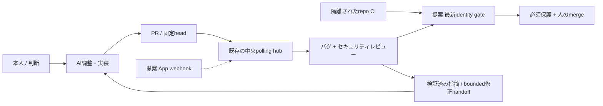

# Multi-AI Workflow

[English](README.md) · [日本語](README.ja.md)

人が判断するAI開発チームの構成、source-only PRレビューツール、設定テンプレートをまとめています。

> **次の開発の入口：[全リポジトリPR品質ゲート・詳細設計](docs/global-review-design.ja.md)**
> 実装開始予定は **2026-11-18 JST**。本更新は文書のみで、今夜は有効化しません。

## 現在あるもの / 次に作るもの

| 項目 | 現source・証拠 | 次の段階 |
|---|---|---|
| PRレビュー | Alibaba OpenCodeReviewとCloudflare手法のlaneはXiaomi MiMo `mimo-v2.6-pro`を使用。過去の限定smoke成功と、その後の不完全なレビューを記録。 | freshな固定revisionで両laneの完全受入。同providerの2laneをprovider独立承認と呼ばない。 |
| 中央hub | poll、予約、署名one-targetのsourceあり。checked-in recurring configはfalse、現在のlive設定は未確認。 | 既存hubを拡張し、対象台帳・提案webhook・最新identityのCI集約を追加。 |
| merge保護・修正 | 人のmerge方針あり。全repo強制とbounded修正自動化はlive受入済みではない。 | 1repoのno-write gate → 既存/新repo登録・保護 → 人承認の修正handoffから段階導入。 |

基準SHA、過去記録の不一致、残る受入は[現状照合表](docs/global-review-design.ja.md#2-現状の照合sourceとliveを分ける)へ。Appの導入やlaneの緑だけでは、全PR保護の証明になりません。

## 構成

テキスト版：人が範囲を決める → 実装AIがPRを作る → hubがレビューを集める → 隔離CIと最新revisionで集約 → 保護設定と人がmerge判断。検証済み指摘を上限付きの修正handoffで戻します。「提案」は稼働済みを意味しません。

## 読み方

- **次の実装を進める：** [詳細設計](docs/global-review-design.ja.md)のP0–P3、未実行の受入ケース、停止条件。
- **既存ツールを使う：** [ツール](tools/README.ja.md)、[2系統レビュー](docs/dual-review.ja.md)、[自動レビュー設定](docs/automatic-dual-review.ja.md)、[中央hub設定と制限](docs/central-review-hub.ja.md)、[署名one-target草案](docs/central-one-shot.ja.md)。
- **チームを理解する：** [AIチーム](docs/ai-team.ja.md)、[routing](docs/routing-guide.ja.md)、[handoff](docs/handoff-templates.ja.md)、[役割・構成参考](docs/network-topology-2026-11-08.ja.md)。
- **設定・貢献：** [configs](configs/)、[templates](templates/)、[レビュー方針](docs/pr-review-pipeline.ja.md)、[repo方針](AGENTS.md)。`docs/*`、`feat/*`、`fix/*`等の短命branchから`main`へPRを作ります。
- **履歴を確認する：** [以前の入口](docs/archive/landing-before-global-review.ja.md)、[archive索引](docs/archive/README.ja.md)、[変更履歴](CHANGELOG.ja.md)。日付付き観測は現在のruntimeの証明ではありません。

文書はAPI課金・source外部送信・書込み権限・workflow有効化・mergeを許可しません。開発workerは承認された案件ごとに選び、過去のmodel試行を全環境のdefaultと解釈しません。
