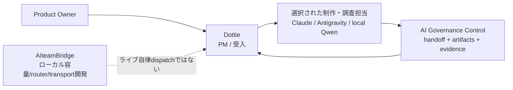

# Multi-AI Workflow Architecture

[English](README.md) | [日本語](README.ja.md)

認可済みのツール間で実装、検証、報告を調整するための公開資料です。日付付きの節にあるモデル名は本人の運用上の呼称であり、サービスの提供仕様や実行時のモデルIDを確認したものではありません。

## 現在の運用 — 2026-10-22

これは本人申告に基づく手動運用の状態です。リポジトリ内の確認は文書と図を対象とし、非公開正本の内容やモデルサービスの稼働を検証するものではありません。

dotが本人の依頼を整理し、認可済みの適切な担当を選び、結果・テスト・PR・CIを確認して本人に報告します。最終判断と受入は本人が行います。担当と実行環境は案件、本人の最新指示、接続状況により選び、Windowsとクラウドを使い分けます。公開ソースや合成テストは非公開の実データと分離します。

- Claudeで実装しCodexで独立検証する案件があります。本人がCodexを明示した案件では、Codexが実装・テスト・PR準備まで進めます。全案件にClaude先行やGemini先行を固定しません。
- Windows CLIが環境上の問題で止まった場合も、案件ごとに独立して認可されたGUI経路や公開コードのクラウド検証だけを使います。セキュリティ制限を維持し、権限拒否を別経路で回避しません。
- ダッシュボードの正本はWindowsの非公開ボードです。差分inboxは受け渡しであり、適用済みではありません。更新担当はタスク名・目的・本人の最新指示を照合し、一意IDと元日時を保ち、バックアップ・読戻し・receiptを確認してから完了扱いにします。公開・ローカル画面との同期は別に確認します。
- 通常設計の更新担当はAntigravityです。2026-10-22は利用不能となり、本人の担当変更指示を経て、Codexが直接依頼による一時的な正本更新を通常のBacklog CLIで完了しました。保存済みの定期handoff指示は受け渡し専用のままで、Codexによる自動適用へ移っていません。
- MiMo、Qwenなどは日付付きの公開記録にある状態を維持します。この更新だけで新たな実稼働は認定しません。

### 案件と検証の流れ


[SVGを拡大](assets/workflow-architecture.ja.svg) · [Mermaid原本](tools/architecture/workflow.ja.mmd)

### ダッシュボードの正本境界


[SVGを拡大](assets/dashboard-boundary.ja.svg) · [Mermaid原本](tools/architecture/dashboard.ja.mmd) · [再生成手順](tools/architecture/README.md)

以下は日付付きの判断と観測の記録です。担当や稼働状態がこの2026-10-22の記述と異なる場合は、この節を参照し、実行時の利用可否を改めて確認してください。

## モデル・効率化運用方針 — Gemini 3.8 Flash ベースと昇格・復帰（2026-10-19更新）

**合意された運用方針：**
- **Flashベースと昇格・復帰:** 通常の実装・修正・調査のベースモデルを **Gemini 3.8 Flash** とします。effort（Low/Medium/High等）は普遍的な既定値とせず、タスクの性質や本人指定時に個別に選択・記録します。難所・ブロック発生時は上位モデル（Sonnet、GPT-6.1 Sol Medium、所定の限定的Claude Opus等）へ選択的に昇格し、Gemini 3.8 Flashが利用可能ならベースモデルへ復帰します。Flashの利用枠がなくなった場合は、Claude Code（Sonnet 5.5／Opus 5.5）またはGemini 4 Argonを手動選択します。ただしArgonの利用枠は少ないため、必要な難所用に温存し、残枠やタスク適性を確認します。自動切替は未導入です。
- **差分中心の引き継ぎ:** 引き継ぎ内容は**差分・成果物参照（パス/SHA/diff）・構造化要約（目的・現状・根拠・次のステップ）**に絞り込み、会話履歴全体の全件再送は禁止します（「直近Nターン」の一律義務化は行わず、タスクに必要な最小限を渡す）。
- **失敗原因の分類と停止:** 失敗原因を環境エラー、権限拒否、タイムアウト、品質未達に分類します。権限拒否は即時停止（fail-closed、迂回再試行禁止）。通常失敗は1回で原因と成果物を保存し、認可済みの代替1候補を検討します（最大1回の代替。承認なき無制限リトライは禁止）。
- **最大2並列の運用上限:** 並列作業は人間による手動管理下の運用上限目標として「最大2独立タスク」とします（リポジトリ実装済みの自動並列ディスパッチではありません）。
- **明確な完了条件:** レビュー対象head SHAと検証head SHAの完全一致、必要なCI/静的検査の合格、未解決の重要指摘（Blocker/Major）の解消、人間（Product Owner）による最終受入を必須ゲートとして維持します。
- **Quotaと費用の別計測:** サブスク枠観測（窓と時刻）とAPI使用量・課金は別フィールドで記録し、混算・合算を禁止します（数値は取得できる時のみ記録）。未取得・古い観測値は `unknown` とし、明示的な手動選択・確認へ戻します。
- **レビュー候補:** 独立レビュー候補として **Xiaomi MiMo-V2.6-Pro API** を位置づけます（全種類代替とは固定せず、別provider原則と人間の最終受入を維持）。
- **今日版チェックリストと検証例:** 2026-10-19版の実運用効率化チェックリスト（5項目）および本レビュータスク（PR #27反映）に基づく実測データ検証例は、[2026-10-19-mimo-efficiency-review.ja.md](docs/reports/2026-10-19-mimo-efficiency-review.ja.md) を参照してください。

### 更新履歴（Changelog）— 2026-10-19
- **効率化運用方針の具体化:** Gemini 3.8 Flash をベースモデルとし、難所での昇格と解決後の通常モデル復帰、差分・成果物参照中心の短い引き継ぎ（会話全文再送禁止）、失敗原因分類（権限拒否即停止、通常失敗は1回保存＋代替1候補）を明文化。
- **運用上限と完了条件の厳格化:** 手動管理下の最大2並列タスク上限、head SHA一致・CI合格・重要指摘解消・人の受入に基づく完了条件、サブスク枠とAPI課金の別計測（混算禁止）を統合。

## MiMo APIの活用拡大とLiteLLMゲートウェイ検討案（2026-10-19追記）

**状態：アイデアの文書化のみ。** 現行のMiMo V2.6 Proは、既存のOpen WebUIから必要時に手動で呼び出す**独立レビュー用途**で利用中。以下は追加活用の**候補**であり、実装済みの自動化や新しい必須運用ルールではありません。

- **開発前：** 要件整理、受入条件の明確化、設計案とリスクの比較、ADR案、タスク分割。
- **資料作成：** README、設計書、運用手順書、テスト計画書、変更履歴、日英の技術要約、根拠付き比較資料の下書き・レビュー。情報収集と事実確認は別途実施する。
- **開発後：** 要件・実装・テストの整合確認、diff・テスト結果・静的解析結果の要約、指摘事項とリリースノートの草案。
- **セキュリティ／運用：** 秘密情報を除去したSemgrep/Trivy結果やログのトリアージ、影響と対処候補の整理、運用チェックリスト作成。モデルの出力のみで脆弱性確定や修正完了と判断しない。
- **任意の手動PoC：** 分類・要約・構造化JSON出力を試し、効果があれば将来のn8n/Dottie連携を検討する。この記載は無人ディスパッチ、PR自動投稿、自動マージを承認しない。

**運用条件：** MiMoはCIや別providerによる独立検証、人による最終受入の代替としない。実案件で品質・誤検知／幻覚・入力／出力トークン・待ち時間・API費用を評価し、サブスク利用枠とは別管理する。外部APIへ送る情報は必要最小限にし、秘密情報・個人情報・機密コードを除外。提供元のデータ取扱条件も確認する。

**LiteLLMゲートウェイ：今後の改修候補、導入未決定。** Open WebUI、n8n、認可済みAIエージェントから、MiMo、将来契約する場合のDeepSeek、その他個別に利用可能なAPIやローカルLLMへ共通入口を提供する案。クライアント別認証・利用量／予算管理、監視、フォールバック、対応するルーティングを集約できる可能性がある。ただしLiteLLM自体はモデル利用権・APIクレジット・エージェントの実行制御を提供しない。用途に応じた自動選択には呼び出し元の明示的指定や別途分類ロジックが必要。

**保留理由と判断基準：** 現行環境だけでも複雑であり、ゲートウェイを追加するとサービス運用・設定・認証情報・アップデート・セキュリティ・障害復旧の負荷が増える。当面はMiMo→Open WebUIの直接接続を維持。複数API・複数クライアントの管理負担が実測で問題になった場合に再検討する。PoC前には直接接続との運用コスト比較、修正版・脆弱性情報、LAN内限定アクセス、秘密情報管理、障害時動作、制限・課金可視化、ロールバックを確認。DeepSeekへの移行判断も**未決定**とし、同じ実タスクで品質・時間・費用を比較する。本追記による稼働環境変更・新規契約・課金・認証情報追加は行わない。

2026-10-19時点の構成図のMermaid原本：[`assets/workflow-architecture-2026-10-19.ja.mmd`](assets/workflow-architecture-2026-10-19.ja.mmd)。2026-10-19にラベルを更新した記録であり、MiMoの追加用途が実稼働したことは示しません。

## Daybreak対象モデルと認可されたOSSセキュリティレビュー（2026-10-16）

**文書化のみ・未有効化：** OpenAIのDaybreak（Trusted Access for Cyber）には、Blue（認可された防御作業向けに拒否を減らす）とRed（別途承認される専門のサイバーアクセス）があります。公式APIガイドでは、Blue系の利用は `gpt-6-sol`、およびRed級の承認とプロジェクトのアクセスを要する `gpt-6.1-sol`／`gpt-6-astra`、Redは `gpt-5.6-cyber` です。出典ページ間で提供物の呼び名が一致せず、未解決のまま記録しています。本リポジトリはアクセスを保有するとは主張せず、Daybreakのリクエストやスキャンも実行していません。認可されたOSSレビューは、書面での範囲と承認の確認、隔離した最小権限の環境、独立した検証、協調的開示、未修正の詳細を公開成果物に載せないこと、を提案としてまとめています。定常のモデル選択とレビュー標準は変更しません。[Daybreakと認可されたOSSセキュリティレビュー](docs/daybreak-authorized-oss-security-review.ja.md)（[English](docs/daybreak-authorized-oss-security-review.md)）を参照。

## レビュー運用方針 v2026.10.15-r2 — MiMo-V2.6-Pro API（2026-10-15）

**本人が選択した今後の標準方針（実運用は未導入）：** 独立した**コード／PRレビュー、検証結果・根拠のレビュー、資料・設計書レビュー**には、原則 **Xiaomi MiMo-V2.6-Pro API** を使用します。MiMo-V2.6-Flashは軽量レビューの比較検証候補であり、品質受入済みの標準ではありません。重大指摘はClaude／Codex、テスト、静的解析などで独立確認し、最終判断は人が行います。

**RunPodはGPU・モデル起動・量子化・推論の技術検証専用**とし、定常PRレビューの標準経路にはしません。過去のRunPod／Qwenレビュー計画は方針変更しますが、検証履歴は保持します。導入前に正しいモデルID・単価・データ取扱条件を確認し、欠陥検出率、誤検知、実費などを実測します。**文書のみの変更で、APIキー・課金・外部通信・レビュー自動化・ランタイム変更は行いません。**

## Gemini 4 Argon の段階的導入方針（2026-10-14）

**将来方針／未適用：** （注：2026-10-17方針により、通常実装のデフォルトにはGemini 3.8 Flashが採用されています。Argonは別途実動作検証を待つ将来候補として維持します。）AntigravityでArgonの実動作が確認できたら、Geminiの担当を3.8 Flash基準からさらに上位の役割へ拡大します。複雑な修正・大規模変更・デプロイはClaude、複雑な設計と限定的PRレビューはGPT-6/Codex、PMはDottie、専門調査と未受入の将来レビュー候補はQwenという役割を維持します。利用可能になるまでは現行の利用可能な担当へ配分し、Argon利用済みとは扱いません。昇格判断は実案件の品質・コスト・利用枠・受入条件に基づきます。[日英の詳細・構成図](docs/gemini-4-argon-rollout.ja.md) / [English](docs/gemini-4-argon-rollout.md)。

## Claude Opus 5.5 Mediumへの限定的な最終エスカレーション（2026-10-15）

本人が選んだGPT/Sol（通常はGPT-6.1 Sol Medium）で難題が停滞した場合、本人は**Claude Opus 5.5 Medium**へ範囲を限った最終エスカレーションを1回行えます。これは経験に基づく本人の運用判断であり、Opusが客観的に最良、またはSolより常に優れるという主張ではありません。発動条件は、同じ失敗の繰り返し、または合意した作業上限内に具体的な進捗がないことです。先に現象・再現手順・試行と結果・未検証事項・制約・受入条件・最小限の非秘密のソース/revisionを保存し、token残量・費用を確認（欠落・古い場合は`unknown`）、指定とruntime観測のmodel/effortを分けて記録し、権限・TLS検証・秘密情報・有料操作の承認を守り、拒否の迂回やruntimeの黙示的変更をせず、現在のrevisionと証拠をレビューし、完了後は通常モデルへ戻します。通常の実装は従来ClaudeまたはAntigravity Sonnetとしていましたが（2026-10-17方針により更新：Gemini 3.8 Flashを実装デフォルトとし、難所のみ上位モデルへ選択的切り替え、Claudeは必要な場合のみ利用）、Codexは設計・調整・レビューのままです。

RunPod Phase 2：Claude Opus 5.5 Mediumで接続試験に合格したという**本人報告**があります。独立した試験ログ、Pod終了、課金停止は当方では未確認です。これはA100の独立レビュー品質や自動運用とは別で、それらは引き続き**未受入**です。Mattermostは難題の例であり、完了項目ではありません。[2026-10-15の決定](docs/operating-decisions-2026-10-15.ja.md)（[English](docs/operating-decisions-2026-10-15.md)）を参照。

## Current Snapshot - 2026-10-13

> 日付付きsnapshot。以下の「Phase 2はmock/offlineのみ」「Codexが最終エスカレーション」は2026-10-15の節により、また実装デフォルト（Gemini 3.8 Flashデフォルト、Claudeは必要時のみ）および進捗確認・引き継ぎ運用は2026-10-17方針により更新されています。Qwenレビューは未受入のままです。

- 人がProduct Ownerとして最終判断・受入を担います。**Dottie**は短い要件・受入条件・配分・進捗のPM、**Codex / ChatGPT（Chappy）**は複雑な初期設計・難しい判断・必要時の最終エスカレーションと、Claude/GeminiのPRへの範囲限定Codex Reviewを担当します。**Claude Code**と**Gemini/Antigravity**には実装だけでなく調査・文章・翻訳・GitHub文書更新・一次レビューも適性と稼働に応じ配分します（注：2026-10-17方針に基づき、実装はGemini 3.8 Flashをデフォルトとし、難所のみ上位モデルへ切り替え、Claudeは必要な場合のみ使用します）。**Qwen local**は許可済み専門調査、**RunPod A100 Qwen**は未受入の将来レビュー候補です。Codexの全文再作成・全面再レビューを標準にしません。
- Windowsを常時稼働のローカル基地かつ第一選択とします。Windowsで進められない場合、Macへ切り替える前にユーザーへ相談します。
- まずClaude / Antigravityの適任かつ余裕ある認可済み候補へ配分します。固定した両者の優先順はなく、適性・残量観測の鮮度・稼働状態・費用を確認します。残量不明は`unknown`、古い観測での手動ローテーションは提案扱いです。異なるproviderのtoken単位を単純合算しません。
- Claude Codeは通常Sonnet 5.5、難しい作業ではOpus 5.5を使います。Claude CodeとAntigravity内Claudeのquota poolは別です。
- 通常のOpenAI選定は **GPT-6 Luna / Medium** または **GPT-6.1 Sol / Medium** の2択です。範囲が明確な作業にはLuna Medium、難度や品質要求が高い作業にはSol Mediumを選び、Low/Medium/Highの6段階運用は行いません。ExtraHighは引き続き使いません。Astraは学術研究や特に難しい上級調査で必要な場合のみ、具体的な理由を示して使う例外です。Sol Mediumで十分ならそれを使います。モデル名は本人の運用上の表記であり、CLI IDやruntimeでの利用可能性を証明しません。
- CodexBarのquota画像は手動で確認します。quota自動取得と完全自動routingは未検証です。欠落・古い観測は`unknown`として扱い、現在値のようにroutingへ使いません。

[現行の運用判断](docs/operating-decisions-2026-10-13.ja.md)と[Routing Guide](docs/routing-guide.ja.md)を参照してください。

## Codex Review / PR Review Pipeline — 2026-10-13

**今回の追加：** AIによる実装 → 別AIのレビューと再現可能なCI → 指摘修正・新headで再確認 → リスクと権限に応じたマージ。Claude/GeminiのPRにはCodex Review、Codex実装にはClaude/Geminiを選びます。Qwenは品質未受入の将来候補です。

[詳細・構成図](docs/pr-review-pipeline.ja.md)、[運用更新](docs/operating-decisions-2026-10-13.ja.md)、[更新履歴](CHANGELOG.ja.md)を追加し、役割・routing・handoff・保守手順も日英で更新しました。レビュー規則とPRテンプレート付きです。自動レビュー・必須CI・自動マージのlive設定は別途確認する段階です。

## 役割とワークフローの境界

| 層 | 責任 | 状態 |
|---|---|---|
| Dottie | PM: タスク範囲、provider／環境選択、進捗、受入 | 人が判断するPM役割。完全自律dispatchとは表現しない |
| AI Governance Control | 再利用できる簡潔なhandoff、成果物、evidenceの層 | AI Governance Control PR #29でminimal-handoffを検証済み。第二の自律orchestratorではない |
| AIteamBridge | 容量観測、routing、transportの実装プロジェクト | ローカル／offline段階。ライブquota取得と自律dispatchは未検証 |

各層は補完的であり、重複する完全自動の司令塔3つとして扱いません。AI Governance Controlの検証済みminimal handoffは[PR #29](https://github.com/moruku36/ai-governance-control/pull/29)（`4fb014a`でmerge）を参照してください。Bridgeの詳細はリポジトリで変わるため、公開文書では日付付きの検証状況と一般的な境界に絞ります。



## Quotaを考慮した選択

- Sessionとweeklyのquota windowは別の計測値として扱います。使用量／残量にはwindowと観測時刻を付けます。
- 5時間利用がなかったことだけではquotaが100%に戻ったとは言えません。古い・欠落した・鮮度のない観測値は`unknown`とし、手動判断に戻します。
- Antigravity Gemini、Antigravity Claude/GPT、native Claude/Codex subscriptionは別々のpoolです。API料金はsubscription quotaとは別です。残高、quota画像、認証情報、個別アカウントの支出は公開しません。
- 難度、品質、環境制約、観測の鮮度、消費ペース、リセット時刻、費用を総合します。固定閾値だけでは決めません。

## 実装と検証の状態

英語・日本語とも **verified/merged**、**local/offline**、**runtime pending**、**proposal** を区別します。ユーザー承認、実行環境での権限承認、ローカルテスト成功、稼働環境への反映は別の段階です。承認が拒否されたら再試行を連打したり別経路で迂回せず、作業を保存して正規の承認経路で止まります。

- AI Governance Controlのminimal-handoffはPR #29で検証済みです。Ubuntu/Windows品質ゲートと、offlineのcontainer-boundary検証を含みます。ライブ自動化を意味しません。
- AIteamBridgeのcapacity/router作業はlocal/offlineで246 testsと報告されています。未commit／未publishであり、ライブの自律quota取得／dispatchは未検証です。この日付付き根拠を更新する際は対象repoを再確認してください。
- 監督付きAntigravity Webセッション1件でタスク依頼と応答を確認し、取得した結果にはunit check 324件とmock browser check 25件が報告されていました。この単一結果はCLI稼働、一般的な自動routing、テストの独立再実行を証明しません。
- CodexBar quota画像の確認は手動です。自動読み取りやquota対応routing全体の自動化を主張しません。

## QwenとオンデマンドGPUの状態

- **Local：** Windows Open WebUI/Ollamaの文章応答は本人操作で確認済み。Mac Open WebUI 0.11.4とQwen2.5 3Bにはローカル応答・Web検索結果の過去観測がある。全環境の検索可否・専門調査品質は別途確認が必要で、自動orchestrationの証明ではない。
- **RunPod Phase 1：** [PR #39](https://github.com/moruku36/qwen-multimodal/pull/39)で小型Qwen2.5-1.5B-Instructの実回答1件とPod削除を記録。A100の独立レビュー品質や全ワークフロー受入ではない。
- **RunPod Phase 2：** *（2026-10-13時点：mock / offlineのみ。2026-10-15以降、Claude Opus 5.5 Mediumで接続試験に合格したという本人報告がある。独立ログでは未確認で、レビュー品質・運用の受入ではない。）* A100によるlive独立レビュー、品質、継続運用は未受入。現時点はCodex ReviewまたはClaude / Antigravityの別providerレビューを使う。会話上の「3.7ぐらい」は未確定な呼称で、モデルIDとして扱わない。
- **Colab：** 固定Q8チャットnotebookは別環境。[PR #35](https://github.com/moruku36/qwen-multimodal-colab/pull/35)のCPU CI 287件（2 skip）はColab/GPU inference・モデルdownload・A100品質の確認ではない。
- OpenAI-compatibleはAPI形式で、有料OpenAI利用を意味しない。単回のHTTP応答を自動起動・接続・終了の完成としない。Pod停止と削除は別で、永続storageやデータ保持にも注意する。この文書改訂ではGPUを起動せず実運用設定を変更しない。

## プライバシーとセキュリティ

このリポジトリは公開です。私的な会話、個人・家族事情、認証情報、ログイン先、quota画像、正確な口座・アカウント残高、これらを含むログは記載しません。一般化した運用制約だけを説明します。文書更新のための新サービス導入、課金、APIキー生成、アプリ実行構成変更、セキュリティ制御の迂回は行いません。

## リポジトリ構成

- `README.md` / `README.ja.md`: 英語・日本語の概要
- [2026年10月5日〜9日の共同作業・人間工数・費用比較](docs/reports/2026-10-05-to-09-ai-team-work-and-human-effort.ja.md)
- `docs/daybreak-authorized-oss-security-review.md` / `.ja.md`: 公式文書に基づくDaybreak対象モデルと、認可されたOSSセキュリティレビューの運用手順案（文書化のみ・未有効化）
- `docs/operating-decisions-2026-10-15.md` / `.ja.md`: Claude Opus 5.5 Mediumへの限定的な最終エスカレーション（最新の日付付き決定）
- `docs/operating-decisions-2026-10-13.md` / `.ja.md`: PRレビュー運用更新（以前の配分方針は2026-10-10記録に保持）
- `docs/operating-decisions-2026-10-02.md` / `2026-10-05.md` / `2026-10-06.md`: 過去の方針・実験記録を保持
- `docs/routing-guide.md` / `docs/routing-guide.ja.md`: ツール選択と通常OpenAIのMedium 2択
- `docs/ai-team.md`: チームの役割
- `docs/dots-codexbar-orchestration.md`: PMと観測の境界
- `docs/handoff-templates.md`: 再利用handoff
- `configs/`: ツール別ガイダンス
- [`configs/openwebui-local-memory-0.11.4/`](configs/openwebui-local-memory-0.11.4/README.ja.md) ([English](configs/openwebui-local-memory-0.11.4/README.md)): バージョン限定のローカル専用Open WebUI Memory運用手順。読み取り専用のconfig検査ツールとバックアップツール付き。検証はオフラインmockのみで、ライブ挙動は未検証

## クイックスタート

```bash
cp templates/.env.example .env
```

直接クライアントを使う通常の作業では環境テンプレートは任意です。公開文書へ認証情報を記載しないでください。
