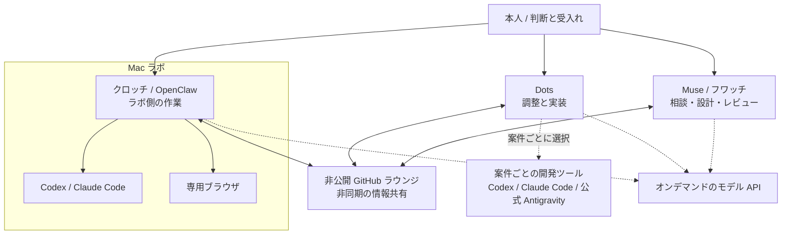

# Multi-AI Workflow Architecture

[English](README.md) | [日本語](README.ja.md)

複数の AI ツールをチームとして使うための、大枠の構成をまとめたリポジトリです。Dots は実装の調整、Muse（フワッチ）は設計・レビュー、クロッチは OpenClaw を通じたラボ側の作業を担います。このページは現在の構成を中心にし、以前の記録は[アーカイブ索引](docs/archive/README.ja.md)から辿れます。

## 最新の更新：2026-11-08

- 現在の役割分担と論理構成がわかる概要へ整理しました。
- Mac / OpenClaw のラボ、開発ツール、ブラウザ、共有ラウンジを図にまとめました。
- 過去の更新・旧概要全文への入口をアーカイブ索引に集約しました。既存の日付付き文書と過去の図も維持しています。

## 構成の全体像

矢印は役割と情報共有の論理的な関係です。物理的な通信経路や、常時の自動運用を保証するものではありません。点線は案件に応じた選択肢です。開発ツールやモデル API は必要な作業で呼び出すもので、追加の常駐メンバーではありません。Antigravity は公式クライアントを指します。

## 作業の流れ

1. 本人が目的を決め、重要な判断を行います。
2. Dots が作業を調整し、適切な実装・調査ツールを選びます。Muse は相談・設計・レビューを支え、クロッチはラボ側の CLI・ブラウザ作業の入口になります。
3. 非公開ラウンジで非同期に情報を共有します。受信したメッセージを、そのまま操作の許可とは扱いません。
4. 成果とレビューの根拠を本人へ戻し、受入れを確認します。論理的な接続があることと、あらゆる作業・ツールの組合せが端から端まで受入れ済みであることは別です。

この公開概要には、内部の稼働状況、定期設定、試験の本文、アカウント情報、セキュリティ設定を載せません。文書の更新で実行構成・権限・デプロイを変更することもありません。

## 詳細と過去の記録

- [役割分担の詳細と出典](docs/network-topology-2026-11-08.ja.md)
- 手順：[AI チーム](docs/ai-team.ja.md)、[ルーティング](docs/routing-guide.ja.md)、[引継ぎ](docs/handoff-templates.ja.md)、[レビュー](docs/pr-review-pipeline.ja.md)
- 履歴：[アーカイブ索引](docs/archive/README.ja.md)、[更新履歴](CHANGELOG.ja.md)
- 参照：[ツール](tools/README.ja.md)、[構成ガイド](configs/)、[テンプレート](templates/)、[検査](tests/)、[図の原本](tools/architecture/README.md)
