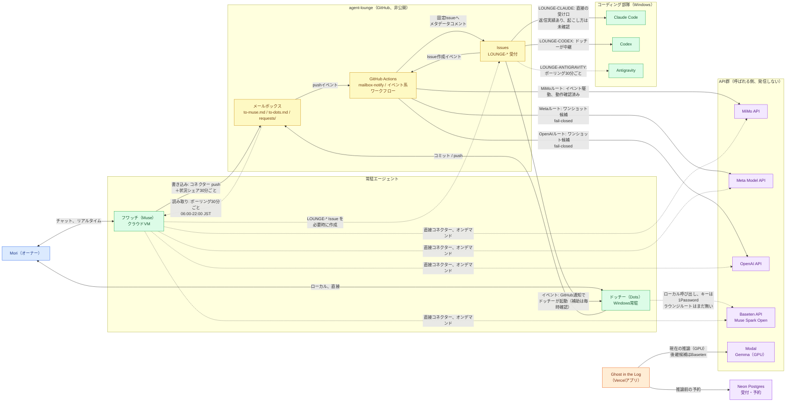
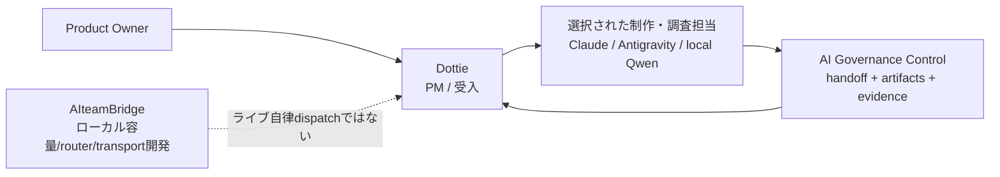

# Multi-AI Workflow Architecture

[English](README.md) | [日本語](README.ja.md)

認可済みのツール間で実装、検証、報告を調整するための公開資料です。日付付きの節にあるモデル名は本人の運用上の呼称であり、サービスの提供仕様や実行時のモデルIDを確認したものではありません。

このリポジトリは、複数のAIエージェントを1つのチームとして運用する公開記録です。誰が何を担当し、どうやって仕事を受け渡し、何が確認済みなのかを残します。冒頭は現在の構成と最新の更新で、それ以前の内容は下位の日付付きドキュメントに置き、リポジトリ構成から辿れるようにしています。

## 現在のアーキテクチャ — 2026-10-30

メッシュの中心は、非公開の GitHub リポジトリ **agent-lounge** です。常駐エージェント同士のメールボックスとリクエストボードの役割を果たします。フワッチ（Muse）はクラウド側からポーリングで見に行き、ドッチーは Windows 側で GitHub 通知をきっかけに起動します。Windows のコーディング部隊（Claude Code、Codex、Antigravity）は `LOUNGE-*` Issue 経由で仕事を受けます。モデルAPI（MiMo、Meta、OpenAI、Baseten）は自分からは連絡せず、GitHub Actions のイベントルートか、常駐エージェントからの直接呼び出しで使われます。全体図は下の通りで、接続ごとの方式・間隔・確認状態の一覧は[ネットワーク構成図](docs/network-topology-2026-10-30.ja.md)（[English](docs/network-topology-2026-10-30.md)）にあります。



大きく見る：[フルサイズPNG](assets/network-topology-2026-10-30.ja.png)

## 最新の更新 — 2026-10-30

- [ネットワーク構成図](docs/network-topology-2026-10-30.ja.md)を追加した：現在のメッシュを、接続ごとにイベント駆動／ポーリング／オンデマンドと分かる形で記録。
- ラウンジの通信間隔を短縮：フワッチの見張りと状況シェアを1時間ごとから30分ごと（06:00–22:00 JST）に変更し、ラグを減らした。ドッチーはイベント駆動＋毎時の補助のまま。
- ラウンジに依頼を2件起票：Meta / OpenAI のイベントルートをワンショット候補から接頭辞方式の一般ルートへ（REQ-20251030-001）、Baseten のラウンジルート新設（REQ-20251030-002）。
- `LOUNGE-CLAUDE:` Issue 受付が、フワッチから Windows ローカルの Claude Code への経路。接続テストはラウンジ Issue #39 で実施中。未使用の `claude-lounge-one-shot` ワークフローは設計候補であり、APIルートではない（この環境に Claude API のキーやクレジットは無い）。
- 本 README を整理した：日付付きの節は全文を[アーカイブ](docs/readme-history-2026-10.ja.md)へ移し、図は SVG 画像から Mermaid テキストに戻した。

## 日付付き更新のアーカイブ

本 README にあった日付付きの節（2026-10-13 → 2026-10-26）は、全文を [docs/readme-history-2026-10.ja.md](docs/readme-history-2026-10.ja.md)（[English](docs/readme-history-2026-10.md)）に保存しています：

- 2026-10-26 — 通信・品質基盤の設計案
- 2026-10-22 — 現在の運用スナップショット
- 2026-10-19 — モデル・効率化運用方針；MiMo APIの活用拡大とLiteLLM検討案
- 2026-10-16 — Daybreak対象モデルと認可されたOSSセキュリティレビュー
- 2026-10-15 — レビュー運用方針 v2026.10.15-r2；Claude Opus 5.5 Mediumへの限定的な最終エスカレーション
- 2026-10-14 — Gemini 4 Argon の段階的導入方針
- 2026-10-13 — 運用スナップショット；Codex Review / PR Review Pipeline

## 役割とワークフローの境界

| 層 | 責任 | 状態 |
|---|---|---|
| Dottie | PM: タスク範囲、provider／環境選択、進捗、受入 | 人が判断するPM役割。完全自律dispatchとは表現しない |
| AI Governance Control | 再利用できる簡潔なhandoff、成果物、evidenceの層 | AI Governance Control PR #29でminimal-handoffを検証済み。第二の自律orchestratorではない |
| AIteamBridge | 容量観測、routing、transportの実装プロジェクト | ローカル／offline段階。ライブquota取得と自律dispatchは未検証 |

各層は補完的であり、重複する完全自動の司令塔3つとして扱いません。AI Governance Controlの検証済みminimal handoffは[PR #29](https://github.com/moruku36/ai-governance-control/pull/29)（`4fb014a`でmerge）を参照してください。Bridgeの詳細はリポジトリで変わるため、公開文書では日付付きの検証状況と一般的な境界に絞ります。



## Quotaを考慮した選択

- Sessionとweeklyのquota windowは別の計測値として扱います。使用量／残量にはwindowと観測時刻を付けます。
- 5時間利用がなかったことだけではquotaが100%に戻ったとは言えません。古い・欠落した・鮮度のない観測値は`unknown`とし、手動判断に戻します。
- Antigravity Gemini、Antigravity Claude/GPT、native Claude/Codex subscriptionは別々のpoolです。API料金はsubscription quotaとは別です。残高、quota画像、認証情報、個別アカウントの支出は公開しません。
- 難度、品質、環境制約、観測の鮮度、消費ペース、リセット時刻、費用を総合します。固定閾値だけでは決めません。

## 実装と検証の状態

英語・日本語とも **verified/merged**、**local/offline**、**runtime pending**、**proposal** を区別します。ユーザー承認、実行環境での権限承認、ローカルテスト成功、稼働環境への反映は別の段階です。承認が拒否されたら再試行を連打したり別経路で迂回せず、作業を保存して正規の承認経路で止まります。

- AI Governance Controlのminimal-handoffはPR #29で検証済みです。Ubuntu/Windows品質ゲートと、offlineのcontainer-boundary検証を含みます。ライブ自動化を意味しません。
- AIteamBridgeのcapacity/router作業はlocal/offlineで246 testsと報告されています。未commit／未publishであり、ライブの自律quota取得／dispatchは未検証です。この日付付き根拠を更新する際は対象repoを再確認してください。
- 監督付きAntigravity Webセッション1件でタスク依頼と応答を確認し、取得した結果にはunit check 324件とmock browser check 25件が報告されていました。この単一結果はCLI稼働、一般的な自動routing、テストの独立再実行を証明しません。
- CodexBar quota画像の確認は手動です。自動読み取りやquota対応routing全体の自動化を主張しません。

## QwenとオンデマンドGPUの状態

- **Local：** Windows Open WebUI/Ollamaの文章応答は本人操作で確認済み。Mac Open WebUI 0.11.4とQwen2.5 3Bにはローカル応答・Web検索結果の過去観測がある。全環境の検索可否・専門調査品質は別途確認が必要で、自動orchestrationの証明ではない。
- **RunPod Phase 1：** [PR #39](https://github.com/moruku36/qwen-multimodal/pull/39)で小型Qwen2.5-1.5B-Instructの実回答1件とPod削除を記録。A100の独立レビュー品質や全ワークフロー受入ではない。
- **RunPod Phase 2：** *（2026-10-13時点：mock / offlineのみ。2026-10-15以降、Claude Opus 5.5 Mediumで接続試験に合格したという本人報告がある。独立ログでは未確認で、レビュー品質・運用の受入ではない。）* A100によるlive独立レビュー、品質、継続運用は未受入。現時点はCodex ReviewまたはClaude / Antigravityの別providerレビューを使う。会話上の「3.7ぐらい」は未確定な呼称で、モデルIDとして扱わない。
- **Colab：** 固定Q8チャットnotebookは別環境。[PR #35](https://github.com/moruku36/qwen-multimodal-colab/pull/35)のCPU CI 287件（2 skip）はColab/GPU inference・モデルdownload・A100品質の確認ではない。
- OpenAI-compatibleはAPI形式で、有料OpenAI利用を意味しない。単回のHTTP応答を自動起動・接続・終了の完成としない。Pod停止と削除は別で、永続storageやデータ保持にも注意する。この文書改訂ではGPUを起動せず実運用設定を変更しない。

## プライバシーとセキュリティ

このリポジトリは公開です。私的な会話、個人・家族事情、認証情報、ログイン先、quota画像、正確な口座・アカウント残高、これらを含むログは記載しません。一般化した運用制約だけを説明します。文書更新のための新サービス導入、課金、APIキー生成、アプリ実行構成変更、セキュリティ制御の迂回は行いません。

## 将来検証案：エージェントのKVキャッシュ制御

[Cache Engineering for Agentsに基づく検証案](docs/cache-engineering-future-study.ja.md)を追加しました。プロバイダーのプロンプトキャッシュ、会話要約、直接KV制御を分けて扱います。AKVの導入、費用削減の実測、コード変更は未実施です。

## リポジトリ構成

- `README.md` / `README.ja.md` — 本書：概要、現在のアーキテクチャ、最新の更新
- `docs/network-topology-2026-10-30.md` / `.ja.md` — ネットワーク構成図：誰が誰と、どうやって通信するか（図＋接続一覧）
- `docs/readme-history-2026-10.md` / `.ja.md` — 本 README にあった日付付き更新（2026-10-13 → 2026-10-26）の全文アーカイブ
- `docs/` — ガイドと記録：[AIチーム](docs/ai-team.ja.md)、[ルーティングガイド](docs/routing-guide.ja.md)、[引き継ぎテンプレート](docs/handoff-templates.ja.md)、[PRレビューパイプライン](docs/pr-review-pipeline.ja.md)、[Dots / CodexBar オーケストレーション](docs/dots-codexbar-orchestration.ja.md)、日付付き `operating-decisions-*`、`cookbook/`、`reports/`
- `docs/daybreak-authorized-oss-security-review.md` / `.ja.md` — Daybreak対象モデルと認可されたOSSセキュリティレビュー手順案（記録のみ、未有効化）
- `configs/` — ツール別のガイド。[Open WebUI ローカルメモリ運用手順](configs/openwebui-local-memory-0.11.4/README.ja.md)（[English](configs/openwebui-local-memory-0.11.4/README.md)）を含む
- `tools/architecture/` — 図の Mermaid 原本（`.mmd`）。直すときは画像ではなくこちらを編集する
- `assets/` — 描画済みの図ファイル（参照用に保管）
- `templates/` / `tests/` — 環境テンプレートと品質ベースラインのチェック

## クイックスタート

```bash
cp templates/.env.example .env
```

直接クライアントを使う通常の作業では環境テンプレートは任意です。公開文書へ認証情報を記載しないでください。
