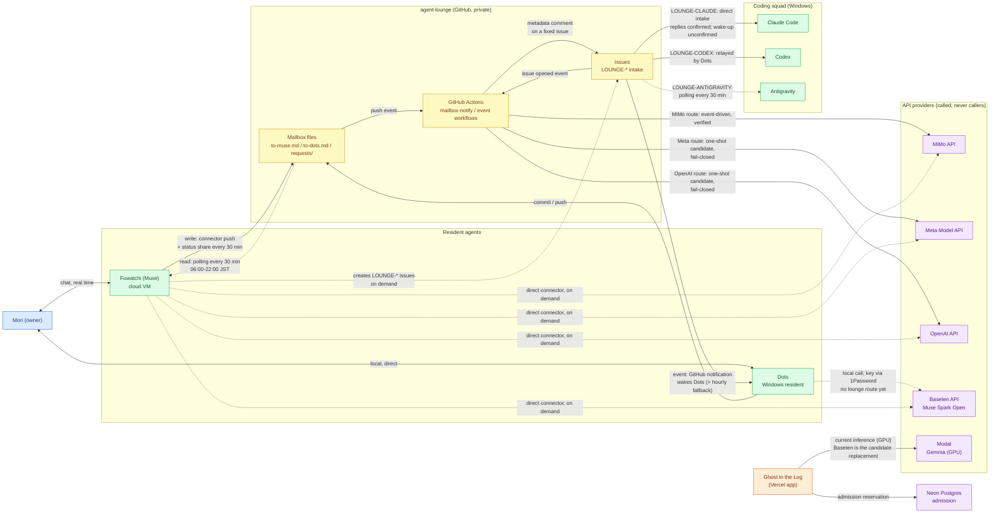
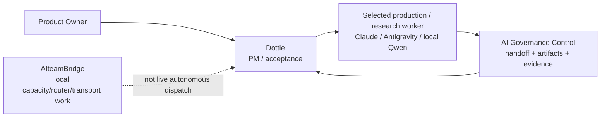

# Multi-AI Workflow Architecture

[English](README.md) | [日本語](README.ja.md)

Public guidance for coordinating implementation, review and reporting across authorized tools. The model names in dated sections are owner-reported operating labels, not verified service specifications or runtime identities.

This repository is the public record of how one owner runs several AI agents as a single team: who does what, how they hand work to each other, and what has been verified. It starts with the current architecture and the latest update; everything older lives in dated documents below, reachable from the repository map.

## Current architecture — 2026-10-30

The mesh is centered on a private GitHub repository, **agent-lounge**, which acts as the mailbox and request board between the resident agents. Fuwatchi (Muse) works from the cloud and reaches the lounge by polling; Dots lives on the Windows machine and is woken by GitHub notifications. The Windows coding squad (Claude Code, Codex, Antigravity) takes work through `LOUNGE-*` issues. Model APIs (MiMo, Meta, OpenAI, Baseten) never initiate contact; they are called through GitHub Actions event routes or directly by a resident agent. The full diagram is below; the per-link inventory, cadences and verification status live in the [network topology snapshot](docs/network-topology-2026-10-30.md) ([日本語](docs/network-topology-2026-10-30.ja.md)).



## Latest update — 2026-10-30

- Added the [network topology snapshot](docs/network-topology-2026-10-30.md): the current mesh, with each link marked event-driven, polling or on-demand.
- Lounge communication cadence shortened: Fuwatchi's mailbox watch and status share now run every 30 minutes (06:00–22:00 JST), down from hourly, to cut lag. Dots remains event-driven with an hourly fallback.
- Two requests filed in the lounge: generalize the Meta and OpenAI event routes from one-shot candidates to prefix-based general routes (REQ-20251030-001), and create a Baseten lounge route (REQ-20251030-002).
- The `LOUNGE-CLAUDE:` issue intake is Fuwatchi's route to the Windows-local Claude Code; a connection test is open as lounge Issue #39. The unused `claude-lounge-one-shot` workflow file is a paper candidate, not an API route — there is no Claude API key or credit in this setup.
- This README was reorganized: dated sections moved in full to the [archive](docs/readme-history-2026-10.md); figures are Mermaid text again instead of SVG images.

## Dated updates archive

Earlier dated sections of this README (2026-10-13 → 2026-10-26) are preserved in full in [docs/readme-history-2026-10.md](docs/readme-history-2026-10.md) ([日本語](docs/readme-history-2026-10.ja.md)):

- 2026-10-26 — Proposed communication and quality foundation
- 2026-10-22 — Current operation snapshot
- 2026-10-19 — Model & efficiency operational policy; MiMo API utilization expansion
- 2026-10-16 — Daybreak models and authorized OSS security review
- 2026-10-15 — Review policy v2026.10.15-r2; Limited final escalation to Claude Opus 5.5 Medium
- 2026-10-14 — Gemini 4 Argon conditional rollout
- 2026-10-13 — Operating snapshot; Codex Review / PR Review Pipeline

## Roles and workflow boundaries

| Layer | Responsibility | Status |
|---|---|---|
| Dottie | PM: task scope, provider/environment selection, progress and acceptance | Human-directed PM role; do not imply complete autonomous dispatch |
| AI Governance Control | Reusable minimal handoff, artifacts, and evidence layer | Minimal handoff verified in AI Governance Control PR #29; it is not a second autonomous orchestrator |
| AIteamBridge | Capacity observations, routing, and transport implementation project | Local/offline stage; live quota retrieval and autonomous dispatch unverified |

These layers complement one another; they are not three overlapping, fully automated command centers. For AI Governance Control's verified minimal handoff, see [PR #29](https://github.com/moruku36/ai-governance-control/pull/29) (merged at `4fb014a`). Bridge details can change with its repository, so keep public claims limited to dated verification and generic boundaries.



## Quota-aware selection

- Treat session and weekly quota windows as different measurements. Used/remaining values must name their window and observation time.
- No activity for five hours does not establish a 100% quota reset. Keep old, missing, or stale observations `unknown` and fail closed to a manual choice.
- Antigravity Gemini, Antigravity Claude/GPT, and native Claude/Codex subscriptions are separate pools. API charges are not subscription quota. Never publish balances, quota screenshots, credentials, or account-specific spending.
- Weigh complexity, quality, environment constraints, freshness, consumption rate, reset timing, and cost. Fixed thresholds alone are insufficient.

## Implementation and verification status

Keep **verified/merged**, **local/offline**, **runtime pending**, and **proposal** distinct in English and Japanese. A user approval, execution-environment authorization, a passing local test, and a production/runtime change are separate stages. Do not repeatedly retry rejected approvals or use another route to bypass them; preserve the work and stop for the correct approval path.

- The AI Governance Control minimal-handoff direction is verified by PR #29 and includes Ubuntu/Windows quality gates and an offline, container-boundary verification. This does not establish live automation.
- AIteamBridge capacity/router work has been reported at 246 local/offline tests; it is uncommitted/unpublished, and live autonomous quota retrieval/dispatch is unverified. Recheck the source repository before changing this dated evidence.
- In one supervised Antigravity web session, a task request and response were observed; the retrieved result reported 324 unit checks and 25 mock browser checks. This is a single web-task result, not proof of CLI operation, general automated routing, or independently reproduced tests. Local Windows CLI status remains unverified.
- CodexBar quota-image review is manual. No claim of automatic reading or complete quota-aware routing.

## Qwen and on-demand GPU status

- **Local:** Windows Open WebUI/Ollama text responses were owner-checked. Mac Open WebUI 0.11.4 with Qwen2.5 3B has past observations of local responses and web-search results. Search availability and specialist-research quality require environment-specific checks; this is not automated orchestration.
- **RunPod Phase 1:** [PR #39](https://github.com/moruku36/qwen-multimodal/pull/39) records one real response from small Qwen2.5-1.5B-Instruct and Pod deletion. It does not accept A100 independent-review quality or the complete workflow.
- **RunPod Phase 2:** *(2026-10-13 snapshot: mock/offline only. Since 2026-10-15 an owner report of a passed connection test with Claude Opus 5.5 Medium exists; it is unconfirmed by independent logs and is not review-quality or operation acceptance.)* Live A100 independent review, quality and ongoing operation are not accepted. Use Codex Review or Claude / Antigravity different-provider review for now. The conversational label “around 3.7” is unresolved and is not a model ID.
- **Colab:** The fixed-Q8 chat notebook is separate. [PR #35](https://github.com/moruku36/qwen-multimodal-colab/pull/35) reports 287 CPU CI checks (2 skipped), not Colab/GPU inference, model-download or A100-quality verification.
- OpenAI-compatible describes an API shape, not paid OpenAI. A single HTTP response does not establish automatic startup, connection and termination. Pod stop and deletion differ, including storage costs and data retention. This documentation change starts no GPU and changes no runtime settings.

## Privacy and security

This is a public repository. Do not include private conversations, personal or family details, credentials, login destinations, quota images, exact account balances, or logs containing them. Describe only general operating constraints. Do not add services, incur charges, generate API keys, change application execution configuration, or bypass security controls as part of documentation work.

## Future study: Agent KV cache control

A [study proposal based on Cache Engineering for Agents](docs/cache-engineering-future-study.md) separates provider prompt caching, summarization and direct KV control. AKV adoption, measured savings and code changes have not occurred.

## Repository map

- `README.md` / `README.ja.md` — this overview: what this is, the current architecture, and the latest update
- `docs/network-topology-2026-10-30.md` / `.ja.md` — network topology: who talks to whom, and how (diagram + link inventory)
- `docs/readme-history-2026-10.md` / `.ja.md` — dated updates formerly kept in this README (2026-10-13 → 2026-10-26), preserved in full
- `docs/` — guides and records: [AI team](docs/ai-team.md), [routing guide](docs/routing-guide.md), [handoff templates](docs/handoff-templates.md), [PR review pipeline](docs/pr-review-pipeline.md), [Dots / CodexBar orchestration](docs/dots-codexbar-orchestration.md), dated `operating-decisions-*`, `cookbook/`, `reports/`
- `docs/daybreak-authorized-oss-security-review.md` / `.ja.md` — Daybreak models per official docs and a proposed authorized OSS security review procedure (documented, not enabled)
- `configs/` — tool-specific guidance, including the [Open WebUI local memory runbook](configs/openwebui-local-memory-0.11.4/README.md) ([日本語](configs/openwebui-local-memory-0.11.4/README.ja.md))
- `tools/architecture/` — Mermaid sources (`.mmd`) for the diagrams in this repository; edit these, not rendered images
- `assets/` — rendered diagram files kept for reference
- `templates/` / `tests/` — environment template and quality-baseline checks

## Quick start

```bash
cp templates/.env.example .env
```

The environment template is optional for the direct client workflow; do not put credentials in public documentation.
