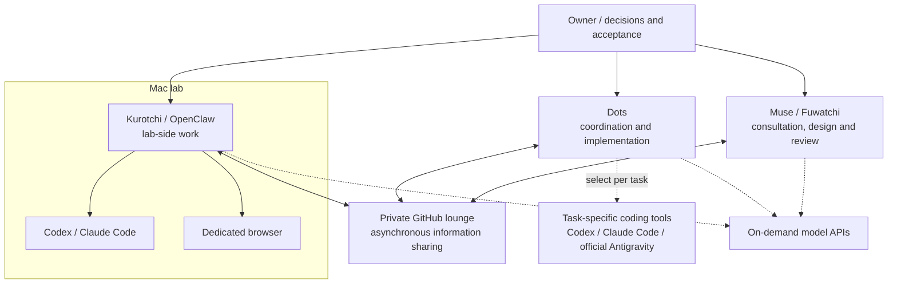

# Multi-AI Workflow Architecture

[English](README.md) | [日本語](README.ja.md)

A high-level map of how several AI tools work as a team: Dots coordinates implementation, Muse (Fuwatchi) supports design and review, and Kurotchi handles lab-side work through OpenClaw. This page focuses on the current structure; older material is reachable from the [archive index](docs/archive/README.md).

## Latest update: 2026-11-08

- Simplified the overview around the current roles and logical architecture.
- Updated the diagram to include the Mac/OpenClaw lab, coding tools, browser and shared lounge.
- Moved the entry point for older updates and complete previous overviews to the archive index. Existing dated documents and historical diagrams remain available.

## Architecture at a glance

The arrows show logical responsibilities and information-sharing relationships, not physical routing or proof of continuous automatic operation. Dashed links are task-dependent choices. Coding tools and model APIs are invoked for a task; they are not additional resident team members. Antigravity refers to its official client.

## How work moves

1. The owner sets the goal and makes consequential decisions.
2. Dots coordinates the work and selects an appropriate implementation or research tool. Muse supports consultation, design and review; Kurotchi provides a lab-side entry point to CLI and browser work.
3. The private lounge provides asynchronous information sharing. A received message is information, not permission to execute it.
4. Results and review evidence return to the owner for acceptance. A logical connection does not mean every task or tool combination has been accepted end to end.

This public overview intentionally omits internal operating status, schedules, test transcripts, account details and security configuration. Updating the documentation does not change any runtime, permission or deployment.

## Read more

- [Detailed role map and source notes](docs/network-topology-2026-11-08.md)
- Guides: [AI team](docs/ai-team.md), [routing](docs/routing-guide.md), [handoffs](docs/handoff-templates.md), [review pipeline](docs/pr-review-pipeline.md)
- History: [archive index](docs/archive/README.md), [changelog](CHANGELOG.md)
- Reference: [tools](tools/README.md), [configuration guides](configs/), [templates](templates/), [tests](tests/), [diagram sources](tools/architecture/README.md)
