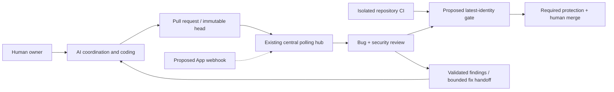

# Multi-AI Workflow

[English](README.md) · [日本語](README.ja.md)

Practical architecture, source-only PR review tools and configuration templates for a human-led AI development team.

> **Next development entry point: [Global PR review — detailed design](docs/global-review-design.md)**
> Japanese engineering specification: [全リポジトリPR品質ゲート](docs/global-review-design.ja.md).
> Implementation is planned from **2026-11-18 JST**. This documentation does not activate anything.

## What exists / what is next

| Area | Current source and evidence | Next step |
|---|---|---|
| PR review | Alibaba OpenCodeReview and Cloudflare-guided lanes use Xiaomi MiMo `mimo-v2.6-pro`. Historical smoke success is not current quality acceptance; later reviews were incomplete. | Accept both full lanes at a fresh immutable revision. Same-provider lanes are not provider-independent approval. |
| Central hub | Polling controller, reservations and signed one-target source exist. Checked-in recurring config gates are false; current live settings are unknown. | Extend the hub with coverage inventory, proposed webhook ingress and latest-identity CI aggregation. |
| Merge protection / repairs | Human merge policy exists; all-repository enforcement and bounded repair automation are not accepted as live. | One-repository no-write gate first; repository enrollment/protection next; human-approved fixes before automation. |

Source baseline, historical discrepancies and outstanding acceptance are in the [reconciliation matrix](docs/global-review-design.ja.md#2-現状の照合sourceとliveを分ける). Neither an App installation nor a green lane alone proves every PR is protected.

## Architecture

Text fallback: people scope work → coding produces a PR → the hub collects reviews → isolated CI and reviews feed a proposed latest-revision gate → protections and a human decide merge. Validated findings return through a bounded fix handoff. Proposed components are not active claims.

## Choose a reading path

- **Build next:** [design guide](docs/global-review-design.md), with P0–P3 units and proposed acceptance cases.
- **Use existing tooling:** [tools](tools/README.md), [dual review](docs/dual-review.md), [automatic review setup](docs/automatic-dual-review.md), [central hub setup and limits](docs/central-review-hub.md), [signed one-target draft](docs/central-one-shot.md).
- **Understand the team:** [AI team](docs/ai-team.md), [routing](docs/routing-guide.md), [handoffs](docs/handoff-templates.md), [role/topology reference](docs/network-topology-2026-11-08.md).
- **Configure / contribute:** [configs](configs/), [templates](templates/), [review policy](docs/pr-review-pipeline.md), [repository guidance](AGENTS.md). Use short-lived `docs/*`, `feat/*` or `fix/*` branches and PRs into `main`.
- **Historical evidence:** [previous landing page](docs/archive/landing-before-global-review.md), [archive index](docs/archive/README.md), [changelog](CHANGELOG.md). Dated observations are history, not proof of present runtime state.

Documentation grants no API spending, source export, write authority, workflow activation or merge permission. Coding tools are chosen per authorized task; historical model trials are not global defaults.
