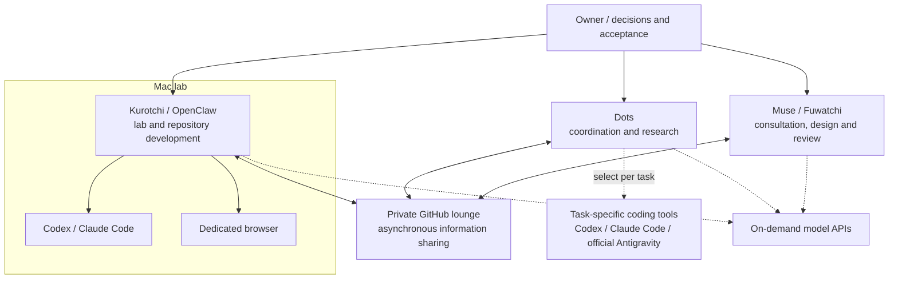

# Multi-AI Workflow Architecture

[English](README.md) | [日本語](README.ja.md)

## Current status — 2026-11-12

This repository holds executable, source-only PR review tooling plus architecture and configuration templates. **Merged implementation is not the same as accepted live automation.**

| Area | Verified stage | Remaining work |
|---|---|---|
| Repository PR review | Alibaba OpenCodeReview + MiMo, and a separate Cloudflare-guided MiMo lane: merged and activated. A bounded smoke run succeeded; later PR reviews were incomplete. | Diagnose failed lanes and validate the exact current revision; do not blindly replay reserved reviews. |
| Central review hub | Controller, inactive config, workflow and bilingual guides merged in [#49](https://github.com/moruku36/multi-ai-workflow/pull/49) and [#50](https://github.com/moruku36/multi-ai-workflow/pull/50). Five mocked offline cases passed. | Both config gates remain false; cross-repository execution and recurring activation are not accepted. |
| Team communication | The private lounge is an asynchronous information-sharing boundary. | A diagram arrow, local status save or posted message does not prove delivery, acknowledgment or task execution. |

Coding worker: Codex CLI with `gpt-6.1-sol` / `xhigh`. PR review: Xiaomi `mimo-v2.6-pro` — Alibaba supplies the review tool and Cloudflare supplies audit guidance, not separate model providers, so two lanes on the same provider are not independent-provider approval. Dated evidence and remaining acceptance steps: [automatic PR review](docs/automatic-dual-review.md), [central review hub](docs/central-review-hub.md). This documentation does not enable a workflow, change permissions or grant merge authority.

## Architecture at a glance

Roles: Dots coordinates and researches; Muse (Fuwatchi) supports consultation, design and review; Kurotchi handles lab-side and repository development through OpenClaw. The arrows show logical responsibilities and information-sharing relationships, not physical routing or proof of continuous automatic operation. Dashed links are task-dependent choices; coding tools and model APIs are invoked per task and are not additional resident team members. Antigravity refers to its official client. Older material: [archive index](docs/archive/README.md).

## Branches

`main` is the trunk. Work lands through pull requests from short-lived, prefixed topic branches:

- `docs/*` — documentation and status updates (the largest group)
- `feat/*`, `feature/*` — new tooling, mainly the PR review lanes and central review hub
- `fix/*` — review-pipeline fixes and diagnostics
- `codex/*` — Codex task and handoff work
- `test/*` — activation trials

## How work moves

1. The owner sets the goal and makes consequential decisions.
2. Dots coordinates the work and selects an appropriate implementation or research tool. Muse supports consultation, design and review; Kurotchi provides a lab-side entry point to CLI, browser and repository development work.
3. The private lounge provides asynchronous information sharing. A received message is information, not permission to execute it.
4. Results and review evidence return to the owner for acceptance. A logical connection does not mean every task or tool combination has been accepted end to end.

This public overview intentionally omits internal operating status, schedules, test transcripts, account details and security configuration. Updating the documentation does not change any runtime, permission or deployment.

## Read more

- [Detailed role map and source notes](docs/network-topology-2026-11-08.md)
- Guides: [AI team](docs/ai-team.md), [routing](docs/routing-guide.md), [handoffs](docs/handoff-templates.md), [review pipeline](docs/pr-review-pipeline.md)
- History: [archive index](docs/archive/README.md), [changelog](CHANGELOG.md)
- Reference: [tools](tools/README.md), [configuration guides](configs/), [templates](templates/), [tests](tests/), [diagram sources](tools/architecture/README.md)
