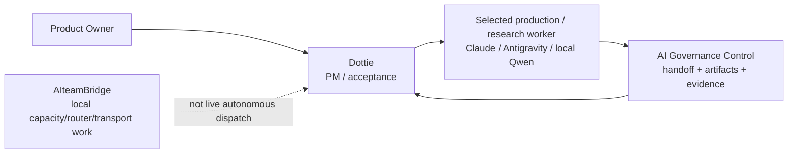

# Multi-AI Workflow Architecture

[English](README.md) | [日本語](README.ja.md)

Public, evidence-aware guidance for coordinating research, implementation, review, writing, and multimodal work across ChatGPT, Codex, Claude Code, Gemini/Antigravity, and Qwen. Model names below are owner-reported operating labels, not claims about API IDs or runtime identity.


[Open the full-size SVG](assets/workflow-architecture.en.svg).

> [!NOTE]
> **Current manual operation vs. unverified automation scope:**
> The diagram illustrates the owner's active manual workflow: Owner direction → Dottie coordination (Codex for handoff and result verification only) → Antigravity Gemini 3.8 Flash primary implementation → manual escalation to higher-tier models for hard problems and return to Flash → independent manual review via MiMo V2.6 Pro in an existing Open WebUI deployment → tests and owner acceptance. Automated routing, automatic dispatch, automated API calls, and automatic merge are unverified and not deployed. To avoid confusion with historical records below (such as the 2026-10-15 API candidate planning), the diagram reflects the active manual workflow.

## Model & Efficiency Operational Policy — Gemini 3.8 Flash Baseline, Escalation & Return (2026-10-19 Update)

**Adopted operational policy:**
- **Flash Baseline with Escalation and Return:** **Gemini 3.8 Flash** is the operational baseline for implementation, bug fixes, exploration, and routine edits. Reasoning effort (Low/Medium/High) is not a universal default; it is selected and recorded per task or upon explicit owner instruction. Escalate selectively to higher-tier models (Sonnet, GPT-6.1 Sol Medium, bounded Claude Opus per rules) only for complex architecture, repeated errors, or hard blockers, and immediately return to the baseline model upon resolving the hurdle or reaching the work limit.
- **Diff-Centric Handoffs:** Handoffs must focus strictly on **diffs, artifact references (paths/SHA/diff), and structured summaries (purpose, current state, evidence, next step)**; copying or resending full completed conversation histories is prohibited (do not mandate rigid N-turn windows; provide only the bounded context needed for the task).
- **Failure Taxonomy and Halt on Denial:** Categorize failure causes into environment, authorization, timeout, and quality. Authorization denials stop immediately (`fail-closed`, no circumvention). Ordinary failures preserve cause and artifacts, considering at most one authorized alternative (max one fallback; no unauthorized runaway retries).
- **Maximum 2 Concurrent Tasks:** Concurrency target is an operational ceiling of at most 2 independent tasks under manual oversight (not an automated dispatch feature in the repo).
- **Clear Exit Criteria:** Maintain exact match between reviewed and verified head SHA, passing required CI/static checks, complete resolution of Blocker/Major review findings, and explicit human (Product Owner) final acceptance.
- **Decoupled Quota and Expense Accounting:** Subscription quota observation (window and timestamp) and API usage/billing must be tracked in separate fields and never commingled (record numbers only when available). Stale or missing observations are marked `unknown`, returning to explicit manual selection rather than an unconditional execution halt.
- **Review Candidates:** Maintain **Xiaomi MiMo-V2.6-Pro API** as an independent review candidate (without fixing it as a sole universal reviewer or compromising the distinct-provider rule).
- **Operational Checklist & Verification Example:** For the 2026-10-19 operational efficiency checklist (5 core items) and the empirical case study based on this review task (merged in PR #27), see [2026-10-19-mimo-efficiency-review.md](docs/reports/2026-10-19-mimo-efficiency-review.md).

### Changelog entry — 2026-10-19
- **Concrete Efficiency Framework:** Formalized Gemini 3.8 Flash as the baseline model with on-demand escalation and immediate return to baseline upon hurdle resolution; established diff- and artifact-centric concise handoffs (no full-transcript dumps); codified failure taxonomy with fail-closed halts on authorization denials.
- **Operational Ceilings and Exit Gates:** Codified manual ceiling of at most 2 concurrent tasks; integrated strict exit criteria (head SHA match, CI pass, blocker resolution, human sign-off); mandated separate tracking for subscription quota vs. API usage/billing (no commingling).

## MiMo API utilization expansion & optional LiteLLM gateway — 2026-10-19

**Status: documented ideas only.** The currently observed MiMo V2.6 Pro use remains **manual, on-demand independent review through the existing Open WebUI**. The following additional uses are proposals, not deployed workflows or a new mandatory default:

- **Before implementation:** structure requirements, clarify acceptance criteria, identify design alternatives and risks, draft ADRs and task breakdowns.
- **During documentation:** draft or review README files, design specifications, runbooks, test plans, change notes, bilingual technical summaries and evidence-based comparisons. Source retrieval and factual verification remain separate responsibilities.
- **After implementation:** compare requirement/implementation/test coverage; summarize diffs, test results and static-analysis findings; draft reviewer questions and release notes.
- **Security and operations:** triage *sanitized* Semgrep/Trivy findings or logs, organize likely impact and remediation candidates, and draft operating checklists. Do not mistake model output for a verified vulnerability or a completed fix.
- **Optional manual pilot:** test lightweight classification, summarization and structured JSON reports before considering n8n/Dottie integration. No unattended dispatch, PR comment posting or automatic merge is authorized by this note.

**Operating guardrails:** Keep MiMo as an *assistant*, not a replacement for CI, independent provider reviews or owner acceptance. Measure task quality, hallucinations/false positives, input/output tokens, latency and API cost separately from subscription quotas. Minimize context and redact secrets, personal data and confidential code before third-party API submission; check provider data-handling conditions.

**LiteLLM gateway — future option, NOT an approved deployment:** An optional OpenAI-compatible proxy could centralize access for Open WebUI, n8n and authorized agents to MiMo, a future DeepSeek API, and other separately provisioned endpoints (including local model servers). Potential value: per-client keys/usage budgets, observability, fallback and supported routing. It **does not provide model subscriptions, API credits or agent orchestration**, and task-aware model selection would require explicit upstream selection or extra classification logic.

**Why defer:** An extra service adds configuration, credentials, updates, security exposure, observability and incident-recovery work to an already complex environment. Prefer retaining the existing direct MiMo→Open WebUI workflow for now. Reconsider only when multiple active endpoints/clients create a measurable management problem. Before any pilot: compare direct connection vs gateway maintenance burden, check version/security advisories, validate local-only access, secret management, failure behavior, rate limits, usage/cost reporting, and rollback. DeepSeek selection or migration is likewise **undecided**; benchmark identical real tasks first. Nothing here modifies production configuration, incurs charges or adds credentials.

## Daybreak models and authorized OSS security review (2026-10-16)

**Documented, not enabled:** OpenAI's Daybreak (Trusted Access for Cyber) offers Blue (reduced refusals for authorized defensive work) and Red (separately approved specialist cyber access). Per the official API guide, Blue-type use covers `gpt-6-sol`, and `gpt-6.1-sol` / `gpt-6-astra` with Red-level approval and project access; `gpt-5.6-cyber` is Red. Source pages name the offerings inconsistently, which is recorded unresolved. This repository does not claim to hold access and has run no Daybreak request or scan. Authorized OSS review is proposed as: written scope and approval check, isolated least-privilege environment, independent validation, coordinated disclosure, and no unpatched details in public artifacts. Routine model selection and the review default are unchanged. See [Daybreak and OSS security review](docs/daybreak-authorized-oss-security-review.md) ([日本語](docs/daybreak-authorized-oss-security-review.ja.md)).

## Review policy v2026.10.15-r2 — MiMo-V2.6-Pro API (2026-10-15)

**Owner-selected future default (not yet deployed):** use **Xiaomi MiMo-V2.6-Pro API** for independent code/PR review, validation/evidence review, and document/design review. MiMo-V2.6-Flash is an optional lightweight pilot, not an accepted default. Validate significant findings with independent Claude/Codex review, tests and static analysis; a human retains final acceptance.

**RunPod is for GPU/model-serving, quantization and inference experiments only**, not the routine quality-review backend. This supersedes the previous proposed RunPod/Qwen review path, preserving historical work. Confirm actual model ID, terms, pricing, data handling, and measure defect detection, false positives and cost before rollout. Documentation only: no credentials, API requests, bills, automated routing or runtime changes.

## Gemini 4 Argon — conditional rollout (2026-10-14)

**Planned, not active:** (Note: per the 2026-10-17 policy, Gemini 3.8 Flash is already adopted as the operational implementation default; Argon remains a separate planned future candidate conditional on runtime verification). When Argon is verified as usable in Antigravity, expand Gemini from routine 3.8 Flash work to broader higher-tier assignments. Keep Claude for difficult multi-step fixes, large changes and deployment, GPT-6/Codex for complex design and bounded independent PR review, Dottie for coordination, and Qwen for authorized research / future unaccepted review. Until then, keep selecting available workers by fit; never imply that Argon is already running. Promotion requires measured pilot quality, quota/cost and acceptance gates, not benchmark-to-seniority analogies. See [Argon rollout plan](docs/gemini-4-argon-rollout.md) ([日本語](docs/gemini-4-argon-rollout.ja.md)).

## Limited final escalation to Claude Opus 5.5 Medium (2026-10-15)

When a hard problem stalls under the owner-selected GPT/Sol worker (usually GPT-6.1 Sol Medium), the owner may make one bounded, final escalation to **Claude Opus 5.5 Medium**. This is the owner's operating judgment from experience, not a claim that Opus is objectively best or always better than Sol. Trigger: the same failure repeats, or no concrete progress within the agreed work limit. First preserve the phenomenon, reproduction, attempts/results, unverified items, constraints, acceptance criteria and smallest non-secret source/revision; check token capacity/cost (`unknown` if missing/stale); record requested vs observed model/effort; respect permissions, TLS validation, secrets and paid-action approvals; never bypass a denial or silently change the runtime; review the current revision and evidence; then return to the ordinary model. Routine implementation previously stayed with Claude or Antigravity Sonnet (superseded on 2026-10-17: Gemini 3.8 Flash is now the operational default for implementation; switch selectively to an available higher model only for difficult parts, and use Claude only when needed); Codex designs, coordinates and reviews.

RunPod Phase 2: an **owner report** says the connection test passed with Claude Opus 5.5 Medium. Independent test logs, Pod termination and billing stop are not yet confirmed by us. This is separate from independent A100 review quality and automated operation, which remain **unaccepted**. Mattermost is a hard-problem example, not a completed item. See the [2026-10-15 decision](docs/operating-decisions-2026-10-15.md) ([日本語](docs/operating-decisions-2026-10-15.ja.md)).

## Current operating snapshot — 2026-10-13

> Dated snapshot. “Phase 2 mock/offline only” and “Codex as final escalation” below are superseded in part by the 2026-10-15 section above; implementation default and progress checks are superseded by the 2026-10-17 policy (Gemini 3.8 Flash default for implementation, Claude only when needed, lightweight models and 4-item handoffs for progress checks); Qwen review remains unaccepted.

- The human owns final decisions and acceptance. **Dottie** handles short requirements, acceptance criteria, allocation and progress. **Codex / ChatGPT (Chappy)** handles complex initial design, difficult decisions and final escalation when needed, plus bounded Codex Review for Claude/Gemini PRs. **Claude Code** and **Gemini/Antigravity** share research, writing, translation, GitHub docs and first review as well as implementation by fit and availability (note: under the 2026-10-17 policy, Gemini 3.8 Flash is the implementation default, using higher models only for difficult parts and Claude only when needed). **Local Qwen** supports authorized specialist research; **RunPod A100 Qwen** is an unaccepted future review candidate. Full-text Codex rewrites and comprehensive re-review are not the default.
- Windows is the always-on local base and first choice. If work cannot proceed there, consult the user before switching to Mac; Mac is a helper environment.
- First allocate to fitting, available authorized Claude / Antigravity candidates. Neither has a fixed priority: consider fit, capacity freshness, actual availability and cost. Missing capacity is `unknown`; manual rotation under stale observations is a proposal. Do not sum unlike provider token units.
- Claude Code usually uses Sonnet 5.5; use Opus 5.5 for harder work. Its quota is separate from Claude inside Antigravity.
- Routine OpenAI selection uses only **GPT-6 Luna / Medium** or **GPT-6.1 Sol / Medium**. Choose Luna Medium for bounded work and Sol Medium when complexity or the quality bar warrants it; there is no Low/Medium/High six-step ladder. ExtraHigh remains outside the policy. Astra is an exception only when academic research or particularly difficult advanced investigation needs it, with a concrete reason; use Sol Medium when sufficient. These are owner-reported labels, not CLI IDs or proof of runtime availability.
- CodexBar quota images are checked manually. Automated quota retrieval and fully automatic routing are not verified. Treat missing or stale observations as unknown and do not route on them as if current.

See the [current operating decisions](docs/operating-decisions-2026-10-13.md) and [routing guide](docs/routing-guide.md).

## Codex Review / PR Review Pipeline — 2026-10-13

**Added in this update:** AI implementation → separate AI review and reproducible CI → fixes and rechecks at the new head → merge by risk and authorization. Use Codex Review for Claude/Gemini PRs and Claude/Gemini for Codex implementations. Qwen remains a future candidate without accepted review quality.

Added the [design and architecture](docs/pr-review-pipeline.md), [operating update](docs/operating-decisions-2026-10-13.md) and [changelog](CHANGELOG.md), and aligned roles, routing, handoffs and maintenance in both languages. Review rules and a PR template are included. Live automatic review, required CI and auto-merge configuration remain pending separate verification.

## Roles and workflow boundaries

| Layer | Responsibility | Status |
|---|---|---|
| Dottie | PM: task scope, provider/environment selection, progress and acceptance | Human-directed PM role; do not imply complete autonomous dispatch |
| AI Governance Control | Reusable minimal handoff, artifacts, and evidence layer | Minimal handoff verified in AI Governance Control PR #29; it is not a second autonomous orchestrator |
| AIteamBridge | Capacity observations, routing, and transport implementation project | Local/offline stage; live quota retrieval and autonomous dispatch unverified |

These layers complement one another; they are not three overlapping, fully automated command centers. For AI Governance Control's verified minimal handoff, see [PR #29](https://github.com/moruku36/ai-governance-control/pull/29) (merged at `4fb014a`). Bridge details can change with its repository, so keep public claims limited to dated verification and generic boundaries.



## Quota-aware selection

- Treat session and weekly quota windows as different measurements. Used/remaining values must name their window and observation time.
- No activity for five hours does not establish a 100% quota reset. Keep old, missing, or stale observations `unknown` and fail closed to a manual choice.
- Antigravity Gemini, Antigravity Claude/GPT, and native Claude/Codex subscriptions are separate pools. API charges are not subscription quota. Never publish balances, quota screenshots, credentials, or account-specific spending.
- Weigh complexity, quality, environment constraints, freshness, consumption rate, reset timing, and cost. Fixed thresholds alone are insufficient.

## Implementation and verification status

Keep **verified/merged**, **local/offline**, **runtime pending**, and **proposal** distinct in English and Japanese. A user approval, execution-environment authorization, a passing local test, and a production/runtime change are separate stages. Do not repeatedly retry rejected approvals or use another route to bypass them; preserve the work and stop for the correct approval path.

- The AI Governance Control minimal-handoff direction is verified by PR #29 and includes Ubuntu/Windows quality gates and an offline, container-boundary verification. This does not establish live automation.
- AIteamBridge capacity/router work has been reported at 246 local/offline tests; it is uncommitted/unpublished, and live autonomous quota retrieval/dispatch is unverified. Recheck the source repository before changing this dated evidence.
- In one supervised Antigravity web session, a task request and response were observed; the retrieved result reported 324 unit checks and 25 mock browser checks. This is a single web-task result, not proof of CLI operation, general automated routing, or independently reproduced tests. Local Windows CLI status remains unverified.
- CodexBar quota-image review is manual. No claim of automatic reading or complete quota-aware routing.

## Qwen and on-demand GPU status

- **Local:** Windows Open WebUI/Ollama text responses were owner-checked. Mac Open WebUI 0.11.4 with Qwen2.5 3B has past observations of local responses and web-search results. Search availability and specialist-research quality require environment-specific checks; this is not automated orchestration.
- **RunPod Phase 1:** [PR #39](https://github.com/moruku36/qwen-multimodal/pull/39) records one real response from small Qwen2.5-1.5B-Instruct and Pod deletion. It does not accept A100 independent-review quality or the complete workflow.
- **RunPod Phase 2:** *(2026-10-13 snapshot: mock/offline only. Since 2026-10-15 an owner report of a passed connection test with Claude Opus 5.5 Medium exists; it is unconfirmed by independent logs and is not review-quality or operation acceptance.)* Live A100 independent review, quality and ongoing operation are not accepted. Use Codex Review or Claude / Antigravity different-provider review for now. The conversational label “around 3.7” is unresolved and is not a model ID.
- **Colab:** The fixed-Q8 chat notebook is separate. [PR #35](https://github.com/moruku36/qwen-multimodal-colab/pull/35) reports 287 CPU CI checks (2 skipped), not Colab/GPU inference, model-download or A100-quality verification.
- OpenAI-compatible describes an API shape, not paid OpenAI. A single HTTP response does not establish automatic startup, connection and termination. Pod stop and deletion differ, including storage costs and data retention. This documentation change starts no GPU and changes no runtime settings.

## Privacy and security

This is a public repository. Do not include private conversations, personal or family details, credentials, login destinations, quota images, exact account balances, or logs containing them. Describe only general operating constraints. Do not add services, incur charges, generate API keys, change application execution configuration, or bypass security controls as part of documentation work.

## Repository map

- `README.md` / `README.ja.md`: English and Japanese overview
- `docs/daybreak-authorized-oss-security-review.md` / `.ja.md`: Daybreak models per official docs and a proposed authorized OSS security review procedure (documented, not enabled)
- `docs/operating-decisions-2026-10-15.md` / `.ja.md`: limited final escalation to Claude Opus 5.5 Medium (latest dated decision)
- `docs/operating-decisions-2026-10-13.md` / `.ja.md`: PR review extension (previous allocation details remain in the 2026-10-10 record)
- `docs/operating-decisions-2026-10-02.md` / `2026-10-05.md` / `2026-10-06.md`: historical policy and experiment records are retained
- `docs/routing-guide.md`: tool selection and the two routine OpenAI Medium choices
- `docs/ai-team.md`: team roles
- `docs/dots-codexbar-orchestration.md`: PM/observation boundaries
- `docs/handoff-templates.md`: reusable handoffs
- `configs/`: tool-specific guidance
- [`configs/openwebui-local-memory-0.11.4/`](configs/openwebui-local-memory-0.11.4/README.md) ([日本語](configs/openwebui-local-memory-0.11.4/README.ja.md)): version-scoped, local-only Open WebUI Memory runbook with a read-only config inspector and backup tool; offline mock checks only, live behavior unverified

## Quick start

```bash
cp templates/.env.example .env
```

The environment template is optional for the direct client workflow; do not put credentials in public documentation.
