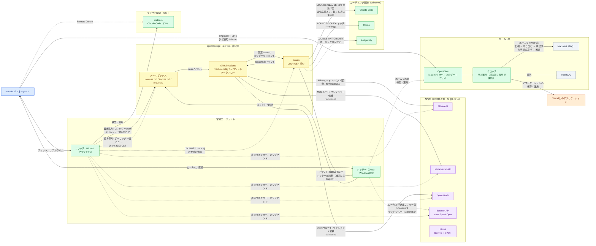

# 11月2日の過去スナップショット

READMEから保存した日付付きの記録です。現在の稼働検証ではありません。

## 過去のアーキテクチャ — 2026-11-02

メッシュの中心は、非公開の GitHub リポジトリ **agent-lounge** です。常駐エージェント同士のメールボックスとリクエストボードの役割を果たします。フワッチ（Muse、Meta のパーソナルエージェント）はクラウド側からポーリングで見に行き、役割は指令・設計・レビュー・確認で、オーナーの日常の窓口とメディア作業（記事・動画）を担います。実際の執筆や構築は、接続済みAPIや他のエージェントに任せます。ドッチーは Windows 側の OpenAI 常駐エージェントで、GitHub 通知をきっかけに起動し、ホームラボの構築・運用を主担当します。Windows のコーディング部隊（Claude Code、Codex、Antigravity）は `LOUNGE-*` Issue 経由で仕事を受けます。モデルAPI（MiMo、Meta、OpenAI、Baseten）は自分からは連絡せず、GitHub Actions のイベントルートか、常駐エージェントからの直接呼び出しで使われます。

2026-11-01〜02 にかけて、環境が2つ増えました。OCI のクラウド開発環境 **midorun**（2026-11-01 構築）は Claude Code を動かし、開発の軸はクラウド環境とホームラボのどちらも Claude Code（CLI）です（2026-11-02 決定）。Anthropic の利用は API を基本とします。ホームラボには Mac mini（M4、2026-11-01 到着）が複数の AI を動かす実験場として加わり、統括ゲートウェイは **OpenClaw**（OSS、セルフホスト）です。ラボ運用エージェント **クロッチ** は OpenClaw 上で動き（2026-11-01 に Hermes Agent ではなく OpenClaw 側の構成で選定）、読み取り専用から開始します：監視 → 切り分け → 承認済み手順の実行 → 確認。オーナーの日常の窓口は LINE、ラボ運用の通知は Discord です。Antigravity は本人の端末で公式クライアントを使う形のみとし、OCI 環境にも OpenClaw にも入れません（2026-11-02 決定。第三者 OAuth 利用に伴うアカウント停止の公表事例を受けた判断）。

全体図は下の通りで、2026-11-02 時点の状態を表します。接続ごとの方式・間隔・確認状態の一覧（2026-10-30 時点）は[ネットワーク構成図](network-topology-2026-10-30.ja.md)（[English](network-topology-2026-10-30.md)）にあります。

大きく見る（2026-11-02 時点）：[フルサイズPNG](../assets/network-topology-2026-11-02.ja.png)。2026-10-30 時点のスナップショットPNGは [assets/network-topology-2026-10-30.ja.png](../assets/network-topology-2026-10-30.ja.png) に残してある。

## 更新 — 2026-11-02

- **ホームラボに統括レイヤーが加わった。** Mac mini（M4）が 2026-11-01 に届き、複数の AI を動かす実験場になった。統括ゲートウェイには OpenClaw（OSS、セルフホスト）を採用し、ラボ運用エージェント「クロッチ」（2026-11-01 に Hermes Agent ではなく OpenClaw 構成で選定）は読み取り専用から開始する：監視 → 切り分け → 承認済み手順の実行 → 確認。窓口は分担し、オーナーの日常の連絡は LINE、ラボ運用の通知は Discord。ホームラボの構築・運用はドッチーが主担当。
- **開発の軸を決定（2026-11-02）。** クラウド開発環境とホームラボのどちらも、軸は Claude Code（CLI）。OCI 環境 midorun（2026-11-01 構築）で Claude Code が稼働し、Anthropic の利用は API を基本とする。
- **Antigravity の方針（2026-11-02）。** Antigravity は本人の端末で公式クライアントを使う形のみとし、OCI 環境にも OpenClaw にも入れない。第三者 OAuth 利用に伴うアカウント停止の公表事例を受けた判断。
- **役割を確認。** オーナー＝PMO・最終判断、フワッチ（Muse）＝指令・設計・レビュー・メディア、ドッチー＝ホームラボの構築・運用、実装の実行＝Claude Code / Codex と接続済み API（Meta Model API、MiMo、OpenAI、Baseten、Modal）。
- **ラウンジの間隔。** フワッチの状況シェアは 2026-11-01 から2時間ごとに変更。見張りは30分ごと（06:00–22:00 JST）のまま。

