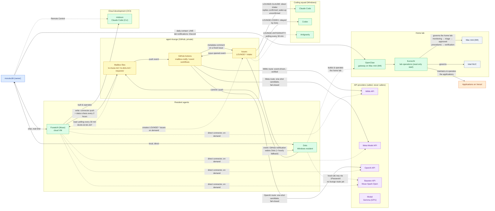

# November 2 historical snapshot

Preserved from the README. These are dated claims, not current runtime verification.

## Historical architecture — 2026-11-02

The mesh is centered on a private GitHub repository, **agent-lounge**, which acts as the mailbox and request board between the resident agents. Fuwatchi (Muse, Meta's personal agent) works from the cloud and reaches the lounge by polling; its role is direction, design, review and confirmation — the owner's daily window and the media desk (articles, videos) — while hands-on writing and building are delegated to connected APIs and other agents. Dots, the OpenAI resident agent on the Windows machine, is woken by GitHub notifications and leads the home-lab build and operations work. The Windows coding squad (Claude Code, Codex, Antigravity) takes work through `LOUNGE-*` issues. Model APIs (MiMo, Meta, OpenAI, Baseten) never initiate contact; they are called through GitHub Actions event routes or directly by a resident agent.

Two environments were added around 2026-11-01–02. The cloud development environment **midorun** on OCI (built 2026-11-01) runs Claude Code, and Claude Code (CLI) is the development axis for both the cloud environment and the home lab (decided 2026-11-02); Anthropic access is API-based as the basic stance. The home lab gained a Mac mini (M4, arrived 2026-11-01) as an experiment host for multiple AIs, with **OpenClaw** (open-source, self-hosted) as its orchestration gateway. The lab-operations agent **Kurocchi** runs on OpenClaw (selected 2026-11-01) and starts read-only: monitoring → triage → approved procedures → verification. The owner's daily contact channel is LINE; lab-operations notifications go to Discord. Antigravity is used only through the official client on the owner's own devices and is not deployed into the OCI environment or OpenClaw (decided 2026-11-02, after public reports of account suspensions tied to third-party OAuth use).

The full diagram is below, reflecting the state as of 2026-11-02. The per-link inventory, cadences and verification status as of 2026-10-30 live in the [network topology snapshot](network-topology-2026-10-30.md) ([日本語](network-topology-2026-10-30.ja.md)).

Larger view of the current diagram (2026-11-02): [full-size PNG](../assets/network-topology-2026-11-02.png). The 2026-10-30 snapshot PNG is kept at [assets/network-topology-2026-10-30.png](../assets/network-topology-2026-10-30.png).

## Update — 2026-11-02

- **Home lab grows an orchestration layer.** A Mac mini (M4) arrived on 2026-11-01 as an experiment host for multiple AIs. OpenClaw (open-source, self-hosted) is adopted as its orchestration gateway, and the lab-operations agent Kurocchi — selected on 2026-11-01 over Hermes Agent — starts read-only: monitoring → triage → approved procedures → verification. Channels are split: LINE for the owner's daily contact, Discord for lab-operations notifications. Dots leads the home-lab build and operations work.
- **Development axis decided (2026-11-02).** Claude Code (CLI) is the axis for both the cloud development environment and the home lab. The OCI environment midorun (built 2026-11-01) runs Claude Code; Anthropic access is API-based as the basic stance.
- **Antigravity policy (2026-11-02).** Antigravity is used only through the official client on the owner's own devices; it is not deployed into the OCI environment or OpenClaw, after public reports of account suspensions tied to third-party OAuth use.
- **Roles confirmed.** Owner = PMO and final decisions; Fuwatchi (Muse) = direction, design, review and media; Dots = home-lab build and operations; coding execution = Claude Code / Codex and the connected APIs (Meta Model API, MiMo, OpenAI, Baseten, Modal).
- **Lounge cadence.** Fuwatchi's status share moved to every 2 hours on 2026-11-01; the mailbox watch stays every 30 minutes (06:00–22:00 JST).

