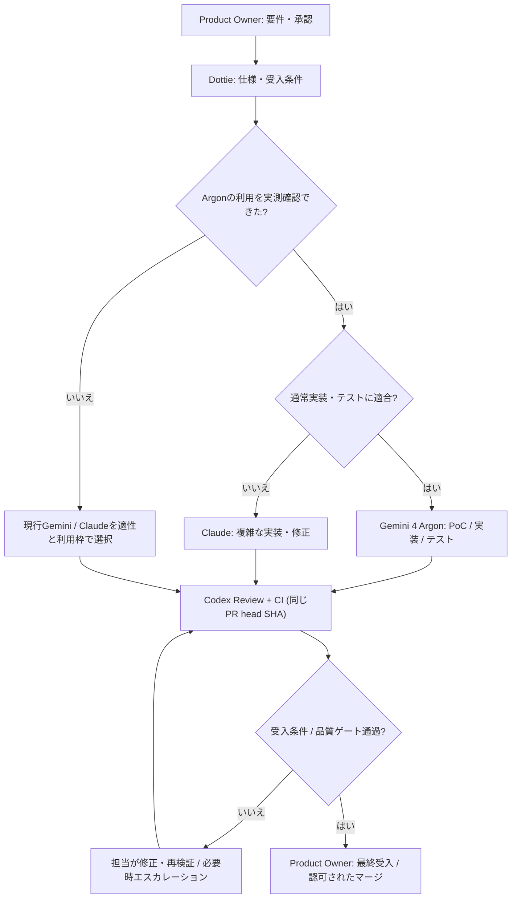

# Gemini 4 Argon 統合方針 — 2026-10-14

[English](gemini-4-argon-rollout.md) | [日本語](gemini-4-argon-rollout.ja.md)

**状態: proposal / runtime pending。** AntigravityでのArgon利用はこのリポジトリの実環境で未確認。モデル名は会話上の名称で、API ID・性能保証ではない。利用開始まで既存の利用可能なGemini/Claude担当を維持し、Argonへ自動切替しない。

## 役割と担当範囲

| 担当 | 期待する業務 | 境界 |
|---|---|---|
| Product Owner | 要件、優先順位、最終受入 | 人が意思決定 |
| Dottie | 短い仕様、受入条件、タスク配分・進捗 | 自律dispatchは未検証 |
| GPT-6 / Codex（Chappy） | 複雑な設計、難しい判断、必要時のエスカレーション、Gemini/Claude実装PRの範囲限定Codex Review | 全成果物の全面再作成を標準化しない |
| Claude Code（通常Sonnet 5.5、難所Opus 5.5） | 複雑な実装、難しいバグ修正、大規模変更、デプロイ | 本番反映は別途認可 |
| Gemini 4 Argon（Antigravityで利用可能になった後） | PoC、モック、通常の機能実装、API/UI、単体・結合テスト、小規模修正、軽量リファクタリング | 品質・難度・残量・実測結果によりClaudeと配分。シニア級という比喩を品質保証に使わない |
| Qwen local | 許可済み専門調査・資料整理 | 実環境ごとの能力確認 |
| RunPod A100 Qwen | 将来の独立レビュー候補 | live品質は未受入。現行レビュアーの代わりにしない |

## 段階的導入

1. **現在（未利用）:** AntigravityでArgonが選択・実行できることを確認できない限り、既存Gemini/Claudeをタスク適性で選択。黙ってArgonを利用済みと記録しない。
2. **利用可能になったら:** モデル表示だけでなく、実行結果と観測可能なモデル情報を確認。料金、利用枠、権限を確認して小規模なPoC、CRUD、UI、テスト作成を試す。
3. **比較:** 同程度の実タスクでArgon / 利用可能なClaudeを比較する。観点は受入条件達成率、テスト通過、修正回数、実行時間、利用枠・コスト、重大バグ／セキュリティ指摘。公開ベンチマークを人間の役職に直接換算しない。
4. **昇格:** 実測が十分なら通常実装・テストの第一候補にArgonを追加する。ただし一律のClaude置換や固定優先順位は導入しない。
5. **エスカレーション:** 大規模な横断変更、難しい障害・性能問題、重要なセキュリティ／インフラ変更、2度以上の修正失敗、品質基準未達はClaudeまたはGPT-6による設計・見直しへ。別providerのレビューとCIを残す。

## 例: PRの流れ

## 実装と検証の境界

- **文書上の将来方針**であり、Antigravity設定、モデル選択、quota router、自動PR、CI、デプロイの稼働状態を変更しない。
- Claude Code と Antigravity、Antigravity内の各モデル群について、同一の利用枠と推測しない。観測が古い／不明なら`unknown`。
- Gemini/Claude実装は原則Codex Review等の別providerレビューを候補とし、PRの同じhead SHAにCI・レビューを紐付ける。セキュリティ重要変更や本番変更は人間が受入れる。
- 参照: [ルーティングガイド](routing-guide.ja.md)、[PRレビューパイプライン](pr-review-pipeline.ja.md)、[既存運用判断](operating-decisions-2026-10-13.ja.md)。
