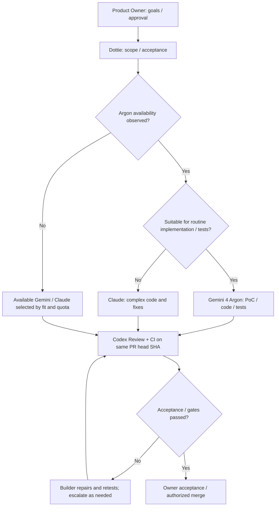

# Gemini 4 Argon Integration Proposal — 2026-10-14

[English](gemini-4-argon-rollout.md) | [日本語](gemini-4-argon-rollout.ja.md)

**Status: proposal / runtime pending.** Gemini 4 Argon availability in this project's Antigravity environment is not verified. The model name is a conversational operating label, not a validated API identifier or performance guarantee. Until availability is tested, keep routing to currently available Gemini/Claude workers; do not silently switch to Argon.

## Responsibilities

| Role | Candidate work | Boundary |
|---|---|---|
| Product Owner | Requirements, priorities, final acceptance | Human remains accountable |
| Dottie | Short specifications, acceptance criteria, allocation, progress | Autonomous dispatch unverified |
| GPT-6 / Codex (Chappy) | Complex architecture, difficult decisions, escalation, bounded Codex Review of Gemini/Claude PRs | No default full rewrite |
| Claude Code (normally Sonnet 5.5; Opus 5.5 for harder work) | Complex implementations, difficult bugs, cross-repo changes, deployment | Production requires separate authorization |
| Gemini 4 Argon (once verified in Antigravity) | PoCs, mocks, ordinary feature implementation, UI/APIs, unit/integration tests, small fixes and refactors | Select by task fit, quality, capacity and measured results; human seniority analogies are not guarantees |
| Local Qwen | Authorized specialist research and source organization | Verify capabilities per environment |
| RunPod A100 Qwen | Potential independent reviewer | Live quality unaccepted; not a present replacement |

## Staged rollout

1. **Before availability:** Use available Gemini and Claude workers by suitability. Do not record Argon as invoked without confirmation.
2. **When accessible:** Verify actual execution and observable model information, plus entitlement, cost and quota. Pilot small PoCs, CRUD, UI and tests.
3. **Measure:** Compare similar real tasks against available Claude options: acceptance pass rate, automated tests, repair rounds, wall time, quota/cost and critical defect/security findings. Benchmarks do not map directly to human job levels.
4. **Promote conditionally:** If pilots pass, add Argon as a preferred candidate for ordinary implementation and testing, not a universal replacement or fixed priority.
5. **Escalate:** Route major cross-cutting edits, difficult incident/performance investigations, sensitive security/infra work, repeated failures or failing quality gates to Claude or GPT-6 design/review. Preserve independent review and CI.

## Example pull request flow

## Operational boundaries

- This is **documentation and planned routing only**. It does not modify live Antigravity selection, quotas, routers, PR automation, CI, deployments or GPU operations.
- Do not assume native Claude, Antigravity, or its model groups share interchangeable quota. Mark stale/missing capacity `unknown`.
- Prefer a different-provider review (such as bounded Codex Review for Gemini/Claude code) and link CI/review to the same PR head SHA. Human acceptance applies to security-sensitive and production changes.
- See [routing](routing-guide.md), [PR pipeline](pr-review-pipeline.md), and [earlier operating decisions](operating-decisions-2026-10-13.md).
