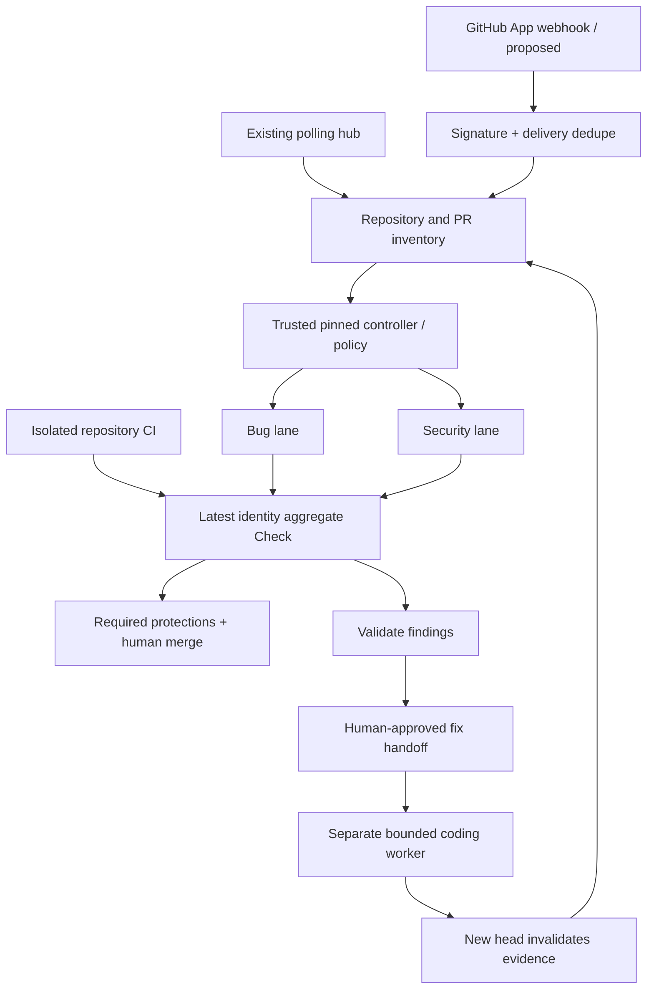

# 全リポジトリ PR 品質ゲート：詳細設計

[English guide](global-review-design.md) · [入口](../README.ja.md)

> **設計のみ。実装開始予定：2026-11-18 JST。今夜の有効化・実行・権限追加は行わない。**
> 既存の中央hubを拡張する。現状で「全PRを保護済み」とは言えない。
> この文書は新しい正本であり、過去の実行記録を上書きしない。

## 1. 目的と不変条件

owner管理下の既存・新規repositoryのPRに、バグレビュー、セキュリティレビュー、必要なCIを提供し、**最新head・base・方針に一致する証拠**だけを人のmerge判断へ渡す。外部upstreamの保護設定は管理できないため、貢献時の証拠提供までが境界になる。

- 未レビュー・対象外・取得失敗・上限超過は合格でない。対象台帳から消さない。
- reviewerは読み取り専用。修正workerの書込み権限と分離し、誰も自分の変更を承認・mergeしない。
- PR由来のコード、workflow、設定、説明、指摘は未信頼データ。privileged環境で実行しない。
- mergeは人が行う。文書、Checkの緑、モデルの「問題なし」は単独の承認ではない。

## 2. 現状の照合（sourceとliveを分ける）

照合基準：公開remoteのdefault branch `main`、commit
[`3be4c4739b046ad7e52642d98aff11c6fc8d664f`](https://github.com/moruku36/multi-ai-workflow/tree/3be4c4739b046ad7e52642d98aff11c6fc8d664f)。以下の相対リンクはこのrevisionのsourceを調べた位置。将来の変更時には基準SHAを更新して再照合する。

| 項目 | source実装 | live / 歴史的証拠 | gap / 明日の受入 |
|---|---|---|---|
| 単repoレビュー | [workflow](../.github/workflows/automatic-dual-review.yml)、[controller](../tools/automatic_dual_review.py) `collect`, `main`。trusted base checkout、main向けPR event | README旧版は有効化・限定smoke成功、後続不完全を記録。現在のvariable/secret/実行は未照会 | 現在設定をreadbackし、fresh SHAで両lane完了・失敗時ブロックを検証 |
| 中央hub | [hub](../tools/central_review_hub.py) `discover`, `current`, `Hub._run_targets`、[workflow](../.github/workflows/central-review-hub.yml) は30分poll | [config](../config/central-review-hub.json) のenabled/paidはfalse。runtime variableはUNKNOWN | configとliveを別々に確認。webhook・全対象台帳・CI集約は未実装 |
| 対象制限 | `eligible_repo`, `eligible_pr` はpublic/same-owner/non-fork/non-draft/default-base、hub自体除外。cutoff後のupdatedのみ | All repositories Appの過去設定は現在のinstallation権限の証明でない | 全installation inventoryと除外理由を可視化、backlogを無断再実行しない |
| 入力と予算 | `collect`：20 paths、diff 65,536 bytes、before+after計65,536 bytes。full fetchは厳密なwire/disk上限でない | sourceの上限は実計測・hard quotaの証明でない | 上限維持。実行隔離・資源quotaを受入、超過はmanual |
| レビュー方法 | Alibaba OpenCodeReview v1.13.7（workflow内SHA256固定）＋[Cloudflare guidance](dual-review.md)、vendor commit `c1c8a8c1471069fb0e188eeaff69b8e8db6564a8` | 両実行providerはXiaomi MiMo `mimo-v2.6-pro`。別手法≠別provider | builder/providerと独立性を記録。必要な別providerレビューが無ければ受入不可 |
| 既存Check | `_run_targets` はcomplete/no findings/no gapsならsuccess。ただしreportは `BOTH_RECORDED_NOT_ACCEPTED` | 独立性・人の受入・CI・protectionの総合合格ではない | 別名のaggregate gateを追加。既存successをmerge許可に流用しない |
| 予約・one-shot | [one-shot](central-one-shot.md)、[auth](../tools/central_one_shot_auth.py)、[provenance](../tools/central_one_shot_provenance.py)、[trust](../config/central-one-shot-trust.json) は既存。署名one-targetとwebhook署名は別物 | 空trust roots、live OIDC/署名保管/並行受入は未受入 | 既存署名をwebhook ingress実装済みと誤認しない。UNKNOWN予約は消さない |
| 修正履歴 | PR56の`1695df06`は基準mainのancestor。非thinking要求の修正を含む | 過去の実レビューはINCOMPLETE/quality未受入。以前のbaseでのrunは新修正の証明でない | output上限2048だけを原因と断定しない。新しいfresh受入が必要 |
| offline記録 | [hub guide](central-review-hub.md)、[one-shot guide](central-one-shot.md) に過去mock記録 | guideの3 mocked cases PASS記録と、別運用記録の未実行/environment-blockedが一致しない。run単位の裏付け未照合 | P0でcase・revision・runを突合。不一致を合算しない。本作業では全て未再実行 |
| merge保護 | [既存方針](pr-review-pipeline.ja.md) は宣言 | plan、account種別、rulesets、expected App、bypassの現在値UNKNOWN | readbackとnegative merge試験が必要。設定済みと主張しない |

## 3. 目標構成



テキスト版：webhookで即時検知しpollで取りこぼしを照合 → trusted controllerが固定sourceを2系統へ渡す → 隔離CIと同一identityで集約 → required protectionと人のmerge。指摘は検証後に別workerへ渡し、新commitは最初から再評価する。

### Trust boundary

- ingressはraw request bytesのGitHub HMAC署名を定数時間比較、delivery ID・event・installation/repoの紐付けと時刻/保持方針を検証。署名secretはPRへ渡さない。event内容だけでsourceや権限を確定せずAPIで再照合。
- controller/policyは承認済みhub commitへpin。PRが変更したcontrol/policy/workflowを同PRの判定に使わない。再利用workflow adapterもSHA固定、入力allowlistと最小permissionを持つ。導入は提案段階。
- target CIはPRコードを実行する別の低権限sandbox。forkにsecret、App token、OIDC、write tokenを渡さない。`pull_request_target`でPR checkout実行しない。
- reviewer AppはContents/PR read＋Checks writeのみ。administrationのbootstrap権限は別operator、修正write権限は別worker。既存Appにはpush能力がない。
- reviewerごとにtool/method/version、provider/model、builderとの関係を記録。provider UNKNOWN、同providerで必要な独立性を満たさない場合はmanual-required。現在の2laneをprovider独立と呼ばない。

## 4. Coverage契約

| ケース | 現在 | 目標・合格しない場合の扱い |
|---|---|---|
| owner public / same-repo PR | 制限付き候補 | enrollment後に全required gate、未登録はmanual-required |
| owner private | discovery除外 | 外部modelへのsource送信同意・契約・retention設定が未決。off/manual、明示同意なしに送信しない |
| future repo | App設定によって発見可能 | inventory→permission→policy→protection readback→negative試験までpending。発見と保護のrace中は未保護と警告 |
| draft→ready | draft除外、ready eventあり | draftはdeferredとして台帳化、readyで最新identityをqueue。draft中も緑にしない |
| fork PR / deleted fork | 中央は除外 | P1はmanual-required。P2以降read-only blob取得＋隔離CIの別受入。head欠落はerror |
| non-default target | 除外 | branch別policyとrequired rulesをbootstrapするまでmanual-required |
| old open PR / cutoff以前 | updated cutoffで除外あり | backlog inventoryは全件、消費済み予約と照合して明示移行。既存cutoffをbackdateして再課金しない |
| big diff / 上限ちょうど・超過 | 上限超過停止 | 部分だけ読んで合格しない。分割は全path coverage manifestと別途設計受入までmanual |
| deletion / rename | absent側null、rename検出なし（delete+add） | 両側sourceとpath数/byte計を検証。rename provenanceを明示、取りこぼしはmanual |
| binary / submodule / symlink / executable mode | `collect`は100644 UTF-8 blob以外拒否 | unsupportedをmanual。依存先commitを読んだふりしない |
| generated files | 自動除外なし | generator/source整合CIを必要化。大きい生成物も無断省略しない |
| archived / disabled | discovery除外 | enrollment停止・保護不能を表示、過去greenを再利用しない |
| repo transfer / App removed | 現在の全coverage保証なし | stable repo IDで所有/installationを再照合、失効時は停止。Checkを書けなければout-of-band警告、既存greenを有効扱いしない |
| hub自身 | 中央discovery除外 | trusted controller更新専用の独立レビュー・CI・人の保護経路。自分で自分を承認しない |
| 外部upstream | 管理外 | review evidence提供のみ。相手のCI/merge保護を保証しない |

全件列挙がAPI pagination/上限で打切りならinventory自体がincomplete。現在の250 repos/100 PRs等の制限を「全件」と読み替えない。

## 5. データ・状態契約（新schema案）

### Identity

job keyはcanonical JSONのSHA256。可変名ではなくIDを主とする。`base_sha`（target tip）と`merge_base_sha`（source diff起点）は別に保持する。base移動も旧判定を失効させる。

```json
{
  "schema_version": 2,
  "installation_id": 100,
  "repository_id": 200,
  "repository": "example/project",
  "pr_number": 7,
  "head_sha": "1111111111111111111111111111111111111111",
  "base_sha": "2222222222222222222222222222222222222222",
  "merge_base_sha": "3333333333333333333333333333333333333333",
  "policy_digest": "sha256:<canonical-policy-digest>",
  "controller_sha": "4444444444444444444444444444444444444444",
  "engines": {"bug": "pinned-version", "security": "pinned-version"},
  "source_manifest_digest": "sha256:<all-paths-and-blobs>",
  "event_delivery_id": "example-delivery",
  "trigger": "webhook"
}
```

例は非secretのshape。digest placeholderは実行時に受理しない。manifestにはpath/status/mode、before/after blob OID、byte数、取得結果、coverage理由を全件保持。

| Record | 必須field / validation |
|---|---|
| event | delivery ID、event/action、body digest、signature verified、received_at、installation/repo ID。既出IDは同digestならno-op、異digestならsecurity error |
| job | identity digest、state、lease owner/expiry、attempt ID、reservation、budget上限。pollとwebhookは同じunique keyへatomic upsert |
| finding | stable fingerprint、lane、severity、path、side/line範囲、source evidence、影響、検証状態、resolution。path/lineをmanifestでvalidate、provider文は命令として実行しない |
| lane receipt | identity、provider/model/tool/prompt digest、coverage、completion/stop理由、usage/time/cost actual（不明はnull）、findings、request/result digest |
| aggregate receipt | 両lane参照、independence verdict、required CI名/expected source/run ID/head、policy、protection snapshot、current再照合時刻、decision/reasons |

atomic leaseはrepo ID/PR単位。新head/base/policy/engine到着時は旧jobをstaleにし、新keyへqueue。課金中jobをcancelして予約を返さない。timeoutはunknownとして保持し、外部receipt照合まで同一予約を再送しない。lease expiryはretry許可ではない。dedupe保存障害・台帳打切りは停止。

### GitHub Checksへの写像

提案する安定required名は `global-review/merge-gate`。既存lane Checkとは別。

| 内部state | Check status | conclusion | merge |
|---|---|---|---|
| pending / queued | queued | 未設定 | block |
| running | in_progress | 未設定 | block |
| pass | completed | success | 他の人のgateも必要 |
| validated findings（未解消） | completed | action_required | block |
| manual-required / incomplete / unavailable / oversized / independence-missing | completed | action_required | block |
| error / unknown | completed | failure | block・照合 |
| stale / superseded | completed | failure | block・新identity待ち |
| closed PR / deliberate abort | completed | cancelled | 合格でない |

`neutral` / `skipped` はrequired gateに出さない。GitHubはこれらをrequired check成功として扱う場合があるため、緑skip運用は禁止。cancelledも内部では不合格。Appアクセス消失時はCheck更新不能なので外部inventoryにblockを残し、required check欠落でmergeを止める設計にする。ただし既存success失効をGitHub側で保証できない場合があるためdrift監査と人の最終照合が必要。

aggregate successの必要条件：全path取得・coverage完了、両laneのschema/identity/完了有効、必要なprovider独立性、blocking findingゼロ、policy指定required CI全て最新identityに適合、最新API照合成功。CIがheadだけを提供する場合はbase互換性/strict up-to-dateまたはmerge queueの統合commit CIも要求する。CIの名前だけでなくexpected App/workflow sourceを確認し、別integrationの同名CheckやPR改変workflowで偽装させない。

merge queue採用時は`merge_group` SHA＋構成PR/head/base集合で別identityを作り、queue用CIとaggregateを再発行する。未対応の間はqueueを対象外/manualにし、PR headのsuccessをqueue SHAへコピーしない。

## 6. Merge enforcementとenrollment

1. P0でaccount種別・plan・repository visibilityと利用可能なruleset/APIをreadback。Org all-repository rulesetsは利用条件を満たす場合の選択肢であり、現accountで使えるとは限らない。
2. Orgでは対象repo/branch条件、required check、expected App、PR review、stale approval dismissal、最新push承認、force-push/deletion禁止、bypass actorを設定・検証。personalは同等のper-repo bootstrapをoperatorが行う。reviewer Appへadministrationを追加しない。
3. enrollment状態：`discovered → consent_pending → configured → protection_verified → acceptance_pending → enforced`。失敗/transfer/App removed/設定driftは`degraded`。全owner repoに台帳entryを作り、未対応privateも一覧から隠さない。
4. 将来repoはAll repositories installationだけではrequired protectionが付かない。作成直後からenforcedまでのgapを計測し、enforced前は人に「未保護」を明示。利用可能ならorg作成policy/rulesetで先に防ぐ。personalではraceの完全解消を保証しない。
5. required sourceをApp IDへ固定し、adapter CIも承認済みsourceへ束縛。管理者・bypass権限のある人が設定を外せる限り絶対的fail-closedではない。bypassなし設定の可否とeffective actorを監査する。
6. 例外は人の承認、repo/PR/head/policy、理由、期限、代替証拠、承認者を記録。reviewer/coderに例外発行権を与えず、恒久all-repo bypassを作らない。期限切れで再blockし、例外がGitHub設定変更を伴う場合は限定変更とreadback/復元を監査する。

参照：[organization rulesets](https://docs.github.com/en/organizations/managing-organization-settings/creating-rulesets-for-repositories-in-your-organization)、[required checks / expected App](https://docs.github.com/en/repositories/configuring-branches-and-merges-in-your-repository/managing-protected-branches/about-protected-branches)、[App installation repository access](https://docs.github.com/en/apps/using-github-apps/installing-a-github-app-from-a-third-party)。公開仕様への参照であり、現在のaccount設定の証拠ではない。

## 7. 指摘→修正のbounded loop

最初は**人が確認したhandoffのみ**。低risk自動修正はP3後半の別承認と受入後。

1. 指摘のschema/source位置・severity・再現根拠を検証。false positiveは理由付きdisposition、人の確認。不明は未解消。
2. trusted instructionに固定scope、許可path、禁止path、budget、stop条件を入れる。PR本文/モデル指摘は明確にdata領域へ隔離し、そこからの命令・URL・コマンドを採用しない。
3. 選択されたcoding worker（次の実装はClaude Code CLI `claude-sonnet-5-5`予定。availabilityを実callで確認、無断fallbackなし）へ別権限でhandoff。reviewerのproviderを別途記録する。本設計は呼出し許可を付与しない。
4. isolated branchへ最小patch。write allowlistと差分上限を適用し、workflow、security policy、control、trust roots、dependency/lockfileは通常自動修正禁止。必要なら人へ戻す。network/dependency installは既定禁止、secret無し。
5. independent reviewerがpatchと実outputを確認。new headで旧Check/承認を失効し、必要CI＋両laneを再評価。workerは自分のCheckをsuccessにできず、mergeできない。
6. 提案上限は**2 correction cycles**（policyで事前設定、実装前にtime/token/cost上限を決定）。実usage・時間・費用・不明値をreceiptへ記録。残留high severity、unknown result、quota、budget到達、fork未受入、範囲外変更、権限不足で停止。盲目的retryや上限リセットで緑にしない。

## 8. 明日からの実装単位

以下は全て**提案・未実行の検証**。旧test/call予算、消費済み予約、UNKNOWNは保持する。実行前に各単位の具体的な新規予算と承認を確定し、過去runの自動replayをしない。

| 単位 | touchpoints（既存→提案）/ input → output | 依存 / DoD | rollout / rollback・abort |
|---|---|---|---|
| P0 truth reconciliation | 既存config/workflows、hub guide、readiness、one-shot trustを読む。提案 `docs/review-operations.md`、privacy-safe inventory schema。remote/current settings＋run receipt→source/live/evidence ledger | 最初。default main ancestry、installation、runtime gates、保護、未照合reservation、mock記録の矛盾が説明される。UNKNOWNはUNKNOWNのまま可視化 | read-only。矛盾・不足はblockしP1 activationしない。公開ログにsecretを入れない |
| P1 one-repo no-write | 既存 `tools/central_review_hub.py`, `tools/automatic_dual_review.py`, workflow/config。提案 `tools/review_contracts.py`, `tools/review_merge_gate.py`, `tests/check_review_gate.py`。固定public同repo PR＋policy＋CI→2lane receipt＋aggregate | P0と明示予算。まずshadow、後にoperatorが1repo required gateを設定。T01–T05/T08/T10受入、fresh trusted revisionで失敗が実際にmergeを止める。source writeなし | 新Checkは旧Checkと並走後required化。旧予約保持。失敗時dispatch停止、pending gateを緑にしない。rollbackでも人のmerge holdを維持 |
| P2 coverage / enrollment | 既存discovery＋pollを維持。提案 `tools/review_webhook_ingress.py`, `tools/review_inventory.py`, `tools/review_protection_audit.py`, `schemas/review-job.schema.json`, pinned reusable workflow adapter。署名event＋全inventory→dedup jobs＋coverage/protection台帳 | P1。T06–T09/T11/T12、pagination切れ、fork、private同意、queue等を個別受入。未対応はmanual-required。全repo enforcementは全件台帳readbackでのみ宣言 | 1repo→少数→owner全体。webhook障害はpollで照合、課金は重複不可。drift/漏れ/誤送信でexpansion停止。App権限rollbackは警告＋merge hold付き |
| P3 fix handoff | 提案 `tools/review_fix_handoff.py`, `schemas/review-finding.schema.json`, `docs/review-fix-runbook.md`。検証済みfinding＋人の承認→isolated patch handoff＋new-head receipt | P1/P2とwrite権限分離。T13/T14。まず人の承認毎回、低riskのみ後で限定自動化を別途判断。自己承認/mergeなし | dry handoff→人承認patch→限定試行。違反時worker権限失効・branch隔離、gateはblockのまま。無断retryなし |

### Acceptance cases（全件proposed、実行数0）

| ID | 入力・操作 | 必須観測結果 |
|---|---|---|
| T01 | known-good small source＋required CI成功＋独立性満足 | 両lane full completion、最新identityだけaggregate success、人のmerge待ち |
| T02 | 実際のbugを含む固定fixture（negative counterexample対も用意） | 指摘のpath/line/evidence検証、blocking状態。検出できなければquality不合格、緑を採用しない |
| T03 | provider outage / truncated output / malformed receipt | errorまたはmanual、null usage保持、予約消費保持、無断再送0 |
| T04 | lane中のhead更新、base移動、policy/version更新 | 旧receipt stale、新identity pending、旧承認を再利用しない |
| T05 | 同event replay、pollとwebhook同時、timeout後lease切れ | 同一job/reservation、課金重複0、unknown照合待ち |
| T06 | 新repoでAppあり・required protection無し | discovered/degraded、coverage alert、enforcedと表示しない |
| T07 | forkがworkflow/指摘へ命令・secret要求を埋込む | privileged PR実行/secret露出0、manualか隔離済み経路のみ |
| T08 | 20/21 paths、byte上限境界、binary、delete/rename、submodule、generated | 全manifest計測、超過/unsupportedはmanual、partial green無し |
| T09 | private、draft→ready、non-default、old backlog | 無同意外部送信0、状態遷移と対象台帳、消費済みpair replay無し |
| T10 | 別Appが同名success、CI失敗/skip/missing、stale approval | aggregate非success、実際のrequired gateがmerge拒否 |
| T11 | App removed、transfer、archive、pagination truncation | inventory degraded/incomplete、失効検知、未保護を隠さない |
| T12 | merge_group、queue SHA変化、同headの別PR/base | identity混同無し、未対応queueはmanual、queue CI別検証 |
| T13 | 修正2回後もhigh残留、UNKNOWN/quota到達 | loop停止、全receipt保持、3回目呼出し0、自己merge0 |
| T14 | 許可外control/lockfile patch、worker write権限不足 | patch隔離・人へhandoff、権限自動拡大0 |

P1のlive費用・設定変更・negative merge試験は別の実行作業であり、本ドキュメント変更では行っていない。mock成功だけでlive gateを受入しない。

## 9. 運用・観測・復旧

### 台帳とprivacy

repo IDごとにowner/visibility/installation、consent、default/対象branch、enrollment、protection digest、expected App、last scan、open PR coverage/reasons、operator actionを記録。名称変更でもIDで追跡。public出力はstate/理由code/非secret SHAと指摘の最小限previewのみ。private path/source、prompt/provider raw text、鍵、header、private correspondenceを公開Checkへ書かない。

retention案：redacted operational receipt 30日、raw provider/source artifactは既定保存しない（必要な調査時はprivate encrypted保管7日、owner同意必須）、dedupe/reservation digestと監査の最小metadataは対象policyの有効期間＋90日。既存immutable予約はこの案で削除せず、移行時に別途retention/法務/削除要件を決める。削除・破損・ledger読み切れ不能は安全停止し、重複課金を許さない。

### Metrics / alerts

- repo enrollment率とprotection verified率、未保護gap時間、open PRのcoverage率（除外/manualも分母に含める）。
- webhook遅延、poll最終成功、queue age、stale率、drift件数、App権限失効、inventory truncation。
- lane完了/unknown率、findingのvalidated/false positive率、known-bug検出率、CI不一致、provider独立性欠落。
- 実latency・token・cost、unknown費用件数、修正cycle数、停止理由、例外期限。未知を0にしない。

### Operator runbook / handoff

1. source SHAとlive gates、installation/protection inventoryをreadback。前回UNKNOWN/予約を先に照合。
2. 新repoはconsent・target branch・CI名/source・expected reviewer App・budget・kill-switch責任者を登録。negative gate試験後にのみenforcedへ。
3. incident時は新規dispatch/provider呼出しを停止し、動作中はbounded終了かunknown照合へ。**kill-switchはpending/errorをsuccess/neutral/skippedへ変えない**。既存required protectionsと人のmerge holdを保持。
4. webhook停止はpoll fallbackを利用するが、ledger/署名/権限/プライバシー障害ではpollも課金停止。既にsuccessだったheadのbase/policy変化を失効させられない場合は保護の不足を明示し人がmergeを止める。
5. 復旧は原因・影響PR・予約・identityを照合し、修正revisionを独立review後、1repo shadow→negative gate→拡大。過去UNKNOWNを再実行で消さない。
6. 引継ぎにはsource/live差、coverage除外、未解決finding、費用actual/null、次の一手・実行予算・停止条件を含める。内部sessionやprivateログは公開しない。

## 10. 未決定事項 / 意図的に延期

- 現account/planのorg all-repo enforcement利用可否、personal bootstrapの保護race対策。
- private sourceの外部送信同意とprovider契約/retention、independent providerの選択と費用。
- fork/非default/merge queue、large diffの全coverage方式、hard runner quota。
- webhookホスト・secret rotation・durable transactional ledgerの実体、署名replay保持期間。
- correctionの具体的time/token/cost枠、低risk自動書込み対象、例外承認者。

これらは不明なまま自動許可しない。P0の事実確定とP1の狭い受入を先に行う。過去の[README記録](archive/landing-before-global-review.ja.md)・各dated guideは履歴として残す。
