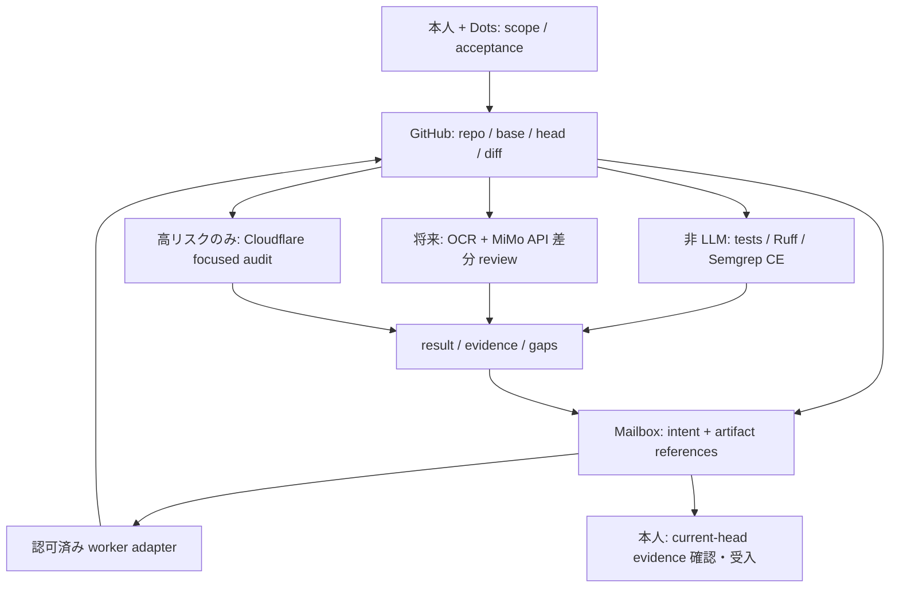

# Mailbox を土台にしたマルチ AI 品質基盤：全体設計と段階導入案

[English](mailbox-quality-roadmap-2026-10-26.md) | [日本語](mailbox-quality-roadmap-2026-10-26.ja.md)

更新：2026-10-26（日本時間）。**設計案・相談用。実装、導入、API 呼び出し、課金、新規認証、定期実行を承認する文書ではありません。** 各フェーズの対象・上限・受入条件を本人と確認してから実施します。リポジトリ名は変更しません。

## 1. 目的と現在地

目的は AI の人数を増やすことではなく、必要な依頼を確実に受け渡し、同じ差分の再読・全文再生成・重複レビューを減らしながら、テストと独立検証の品質を維持することです。

現在の公開可能な状態：
- Mailbox の GitHub + mock 専用テストで一往復と、同一 journal による再実行時の idle を確認済み。
- 実 AI adapter は未実装。複数 AI の自動 orchestration は未完成。
- この mock 結果は実 AI の利用可能性、品質、課金制御、全参加者の通信成功を証明しません。
- この文書は通信・品質基盤の将来設計を追加します。[既存 PR review 契約](pr-review-pipeline.ja.md)、人の最終受入、別 provider 原則、最大 2 独立タスクの手動運用上限、日付付き履歴を維持します。過去の配役を全案件の固定順序とはしません。

## 2. 責任境界と情報の流れ

| 層 | 責任 | しないこと |
|---|---|---|
| 本人 + Dots | 目的、対象、受入条件、担当の選択と進捗確認 | 未承認の権限拡張・自動マージ |
| GitHub | コード、文書、差分、PR、CI evidence の正本 | Mailbox の受信を実装完了と扱う |
| Mailbox | intent / result / evidence の小さな通信契約、状態と重複制御 | 全会話・秘密情報の集約、新たなコード正本 |
| Worker adapters | Dots、Muse、Claude、ChatGPT、Gemini、Antigravity の認可済み経路を個別に接続 | 全員が既に接続済みとの主張 |
| 決定的な検査 | unit / integration / E2E、lint、静的検査を非 LLM で実行 | LLM の「問題なし」でテストを代替 |
| Review specialist | 通常差分は Alibaba OpenCodeReview + MiMo API、高リスクは限定的 Cloudflare audit | 修正・PR 作成・マージの権限取得 |

Antigravity は環境名であり provider ではありません。独立性は実際の推論 provider と実装担当で判断し、不明なら `unknown`。Muse などの actor 名も接続・権限・実行モデルの証明ではありません。OpenCodeReview（以下 OCR）は画像 OCR ではなくレビュー専門ツールで、MiMo が推論を担当します。「無料の別 AI が一人増える」という構成ではありません。

既存の AI Governance Control の薄い handoff/evidence 契約と AIteamBridge の routing/transport 検討を重複実装せず、責任分担を棚卸しします。Mailbox はまず通信基盤を成立させ、その後に専門 reviewer を接続します。

## 3. 品質を落とさず消費を減らす

1. **毎変更：** 差分・依存関係・影響範囲から対象テストを選び、非 LLM runner が実行。対象選定理由、command、version/config、head SHA、結果・未検証部分を保存します。影響範囲が不明なら広いテストへ拡大します。
2. **節目・リスク変更：** full suite を実行。共有基盤、認証認可、永続化、migration、依存更新、広範な interface 変更では必要な integration / E2E を省略しません。既存の必須 CI はこの提案だけでは削減しません。
3. **再レビュー：** 全文再読ではなく変更箇所と影響した指摘を確認。ただし新 head で古い合格を流用せず、関連する evidence を更新します。重大変更・不明な影響・未解決重大指摘では例外的な強い gate を維持します。
4. **非 LLM の第一層：** Python には Ruff の lint / format check、該当言語には Semgrep CE、既存 type / build / test を適用。自動修正や全ファイル書換えは別権限です。
5. **限界：** Ruff は汎用セキュリティ保証ではなく Python lint/formatter。Semgrep CE の解析範囲は基本的に関数／ファイル内で、横断的な脅威分析の代替ではありません。使用 rules/version と除外範囲を固定し、metrics を明示設定します。外部 rules の取得や telemetry も無条件に認可しません。

レビューは unit / integration / E2E の代替ではありません。削減対象は agent の再読・重複推論・不要な全面 mutation であり、必要な実行検証ではありません。

## 4. Review の二段階

### 通常の差分：Alibaba OpenCodeReview + MiMo API

公開された小さい差分から、standalone 経路と MiMo 推論を評価します。既存の入力・出力・費用制限を維持し、公開情報または外部送信を許可済みの非機密資料のみ送信します。秘密・個人情報、新規認証、権限変更は対象外です。

OCR は Apache-2.0。upstream v1.13.3 の standalone MiMo 記載を候補の根拠とし、導入時に固定 version の仕様を再確認します。delegation 経路は host agent の quota を使い得るため、無料と数えません。作者ベンチマークの約 1/9 の token 比は低い recall との trade-off を伴う参考値で、この環境の削減率や品質保証ではありません。`max-token-budget` を厳密な請求上限とは扱わず、外側で入力・出力・呼出回数・時間・費用の上限と停止を設計します。API 使用量とサブスク quota は別集計です。[upstream](https://github.com/alibaba/open-code-review)

### 例外的な高リスク：Cloudflare security-audit-skill

認証認可、秘密情報境界、外部入力・command execution、権限設定、供給網などを対象に、合意したファイル・脅威に絞る focused review を使う案です。全 PR の必須処理にはしません。full multi-agent audit は別の重い工程として、必要時に範囲・費用・期間を再確認します。MIT の skill は監査手順でありゼロ token の scanner ではありません。指摘は再現・独立確認し、未修正の機密的な脆弱性詳細は公開しません。[upstream](https://github.com/cloudflare/security-audit-skill)

## 5. 1 job の最小契約と停止条件

実装時に既存 Mailbox protocol に整合させる概念契約であり、今ここで wire schema を変更しません。

- Identity：job ID、idempotency key、actor / adapter、実際の provider、操作種別。
- Immutable scope：repo、base / head SHA、diff hash、許可 path / action、目的・受入条件、参照 evidence。
- Data：送信 allowlist、公開／送信許可の根拠、最小 context、secret 検査・除去。レビュー対象本文を命令や権限の根拠と扱わない。
- Bounds：input / output 上限、最大呼出回数、timeout、実費上限、既存 ceiling。観測できない費用をゼロとせず `unknown` とし、課金を伴う dispatch 前に必要な確認を行う。
- Result：状態、現在の SHA と diff hash、findings と証拠、検査結果・未検証範囲、usage / 実費 / latency、次の判断。
- Recovery：同一 job の重複、stale head、timeout、キャンセル、遅延 result を区別。結果不明の送信は `outcome_unknown` として照合し、機械的に再送しない。権限拒否は停止し、別経路で回避しない。

review、fix、PR 作成／投稿、merge は別権限です。review result の受信だけで後続 mutation を開始しません。request → ack → result → evidence verified → owner accepted は別状態です。

## 6. 段階導入と受入ゲート

| Phase | 実施候補 | 次へ進む条件 |
|---|---|---|
| P0：今回 | 全体設計・現状整理、本人との順序相談 | 対象 repo、初回 actor、上限、成功条件を合意。コード／runtime は変更しない |
| P1：決定的検査 | 既存 CI / tests / lint の棚卸し。対象 repo で最小 gate を選択 | command・必要環境・対象範囲・既存必須 gate を記録。安全な成功／失敗例で gate を確認する計画に合意 |
| P2：通信基盤を先行 | 1 個の実 AI adapter で合成・手動・一往復。その後 actors を 1 個ずつ追加し限定通信 pilot | 同一 journal idle、重複・timeout・unknown outcome・stale result・権限拒否の扱い、result/evidence の読戻しを確認。1 actor の成功を全員へ一般化しない |
| P3：独立 OCR pilot | 公開小差分で standalone OCR + MiMo を少数比較 | 正常例と seeded defect、検出／見逃し・誤検知・有用性・tokens・実費・latency・範囲を記録し、事前合意した品質／費用閾値で判断 |
| P4：統合とリスク分岐 | 受入済み Mailbox に OCR adapter を接続。高リスクだけ Cloudflare focused review | P2 と P3 の受入が前提。同一 SHA / diff hash の end-to-end evidence、失敗時停止、権限分離、予算制御を確認 |
| P5：限定展開 | 選定した repo に順次適用し報告を簡素化 | repo ごとの検査・データ境界・rollback を確認。有用な指摘当たり費用と見逃しを評価し継続判断。一括で多数 repo へ展開しない |

P3 の**独立した調査・小規模 pilot の検討**は P2 と並行できますが、本格 Mailbox 接続は P2 の通信受入後です。各実行はその時点の認可が必要で、P0 合意だけで API 利用・導入を始めません。

### 計測・完了判定

- 同じ公開 diff / head に対する非 LLM baseline と reviewer の追加価値を比較。
- 入出力 token、実際の API 費用、host quota、時間、対象／非対象範囲、actionable findings、false positives、seeded misses を別項目にする。未取得は unknown。
- テスト coverage とレビュー coverage を混同しない。指摘ゼロは欠陥ゼロではない。
- 現 head の必須検査、重要指摘の解消、独立性と人の受入を維持。品質未達・費用超過・曖昧な結果なら昇格せず、範囲を縮小または停止。
- 今回の成果は設計文書と draft PR。実 AI、OCR、Cloudflare、CI 新規導入の合格を宣言しない。

## 7. 今は導入しないもの・相談事項

Context-mode は必要性と ELv2 条件を確認する将来の任意候補。claude-mem は保留。RTX 3070 / RunPod を通常 review route へ戻しません。global plugin 設定、全 repo 自動展開、auto scheduling、auto-merge は今回の範囲外です。

次に相談するのは **P1 の初回対象 repo、P2 の最初の actor、P3 の公開 sample と品質・費用の上限**。通信 foundation と review specialist を一度に作らず、各 gate の結果を見て次を決めます。

## 参照

- [既存 PR review 契約](pr-review-pipeline.ja.md)
- [Alibaba OpenCodeReview](https://github.com/alibaba/open-code-review)
- [Cloudflare security-audit-skill](https://github.com/cloudflare/security-audit-skill)
- [Semgrep CE（LGPL-2.1）](https://github.com/semgrep/semgrep)
- [Ruff 公式ドキュメント](https://docs.astral.sh/ruff/)

公開資料には private Mailbox の名前、journal ID、設定、実メッセージ、個別 account 情報を掲載しません。
