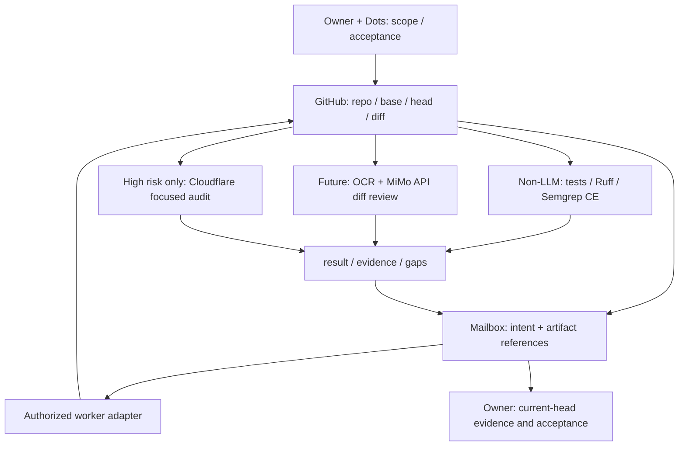

# Mailbox-first multi-AI quality foundation: design and phased roadmap

[English](mailbox-quality-roadmap-2026-10-26.md) | [日本語](mailbox-quality-roadmap-2026-10-26.ja.md)

Updated: 2026-10-26 (Asia/Tokyo). **Design proposal for discussion, not authorization to implement, install, call APIs, incur charges, add credentials, or schedule execution.** Agree scope, limits and acceptance with the owner before each phase. Do not rename the repository.

## 1. Purpose and evidence state

Reduce repeated agent reading, whole-artifact regeneration and duplicate reviews while preserving executable tests and independent verification.

The public-safe current status is limited: a dedicated GitHub + mock Mailbox round trip and same-journal idle rerun have completed. A real AI adapter is not implemented; multi-AI orchestration is unfinished. Mock success establishes neither real-provider availability nor quality, billing control or communication with every actor.

This proposal adds a future communication and quality foundation. Preserve the [existing PR review contract](pr-review-pipeline.md), human acceptance, actual provider independence, the manually supervised ceiling of two independent tasks, and dated historical observations. Historical role assignments are not a universal ordering.

## 2. Responsibilities and flow

| Layer | Owns | Does not imply |
|---|---|---|
| Owner + Dots | Purpose, scope, acceptance, worker selection and progress | New privileges or automatic merge |
| GitHub | Source of truth for code, documents, diffs, PRs and CI evidence | An accepted Mailbox message means implementation is done |
| Mailbox | Small intent / result / evidence contract, state and duplicate control | A second code repository or full-conversation/secret store |
| Worker adapters | Individually authorized routes for Dots, Muse, Claude, ChatGPT, Gemini and Antigravity | All actors are already connected |
| Deterministic checks | Non-LLM unit / integration / E2E, lint and static analysis | Model reassurance replaces execution |
| Review specialists | Proposed ordinary diff review with Alibaba OpenCodeReview + MiMo API; focused Cloudflare audit for high risk | Authority to fix, create/post PRs or merge |

Antigravity is an environment, not a provider. Record actual inference provider and builder; use `unknown` if unobserved. Actor labels, including Muse, do not prove connection, authorization or model identity. OpenCodeReview (OCR here, not image OCR) is a specialist tool using MiMo inference, not an additional free AI.

Inventory existing AI Governance Control handoff/evidence contracts and AIteamBridge routing/transport responsibilities rather than building duplicate orchestration. Establish Mailbox communication before connecting specialist reviewers.

## 3. Save inference, not necessary testing

- **Each change:** choose affected tests from the diff and dependencies; execute through a non-LLM runner. Record selection rationale, command, version/config, head SHA, results and gaps. Broaden testing if impact is uncertain.
- **Milestones and risk changes:** run the full suite. Shared infrastructure, authentication/authorization, persistence, migrations, dependencies and broad interface changes retain applicable integration/E2E gates. This proposal does not remove existing required CI.
- **Re-review:** inspect changed scope and affected findings rather than reread everything. A new head requires refreshed relevant evidence, not reuse of a stale pass. Critical changes, uncertain impact and unresolved major findings retain stronger exceptional gates.
- **First layer:** Ruff lint/format checks for Python, Semgrep CE for applicable code, and existing type/build/tests. Autofix and whole-file mutation need separate authority.
- **Limits:** Ruff is a Python linter/formatter, not general security assurance. Semgrep CE is essentially function/file-limited analysis, not cross-boundary threat analysis. Pin rules/version, record exclusions, and configure metrics explicitly; remote rules retrieval and telemetry are not automatically authorized.

AI review does not replace unit, integration or E2E tests. The savings target is redundant agent reasoning and mutation, not necessary execution.

## 4. Two review levels

### Ordinary diffs: Alibaba OpenCodeReview + MiMo API

Evaluate standalone use on small public diffs. Retain existing input/output/cost ceilings. Send only public information or non-secret material already approved for external transmission; exclude secrets/personal data and do not add authentication or privileges.

OCR is Apache-2.0; upstream v1.13.3 documents standalone MiMo as a candidate route. Recheck the pinned version before implementation. Delegation can consume host-agent quota. The author's approximately 1/9 token benchmark has a lower-recall trade-off, not a local savings or quality guarantee. `max-token-budget` is not a strict billing cap: enforce outer input/output, calls, time and cost limits. Account for API charges separately from subscription quota. [Upstream](https://github.com/alibaba/open-code-review)

### Exceptional high risk: Cloudflare security-audit-skill

Propose focused review of agreed files/threats such as authentication, authorization, secret boundaries, external input/command execution, permissions and supply chain. Do not run it on every PR. Full multi-agent audit is a separate heavier process requiring renewed scope/cost/time agreement. This MIT skill is audit guidance, not a zero-token scanner. Reproduce and independently validate findings; do not publish sensitive unpatched vulnerability details. [Upstream](https://github.com/cloudflare/security-audit-skill)

## 5. Minimal job contract and stop conditions

These are conceptual requirements to map onto the existing Mailbox protocol during implementation, not a wire-schema change now.

- Identity: job ID, idempotency key, actor/adapter, observed provider and action.
- Immutable scope: repo, base/head SHA, diff hash, allowed paths/actions, purpose, acceptance and evidence references.
- Data: transmission allowlist, public/approved classification, minimal context and secret inspection/removal. Reviewed content is data, not authority or instructions.
- Bounds: input/output limits, maximum calls, timeout, actual cost limit and existing ceilings. Unobserved costs are `unknown`, never zero; establish required limits before paid dispatch.
- Result: state, current SHA/diff hash, evidence-backed findings, checks/gaps, usage/cost/latency and next decision.
- Recovery: distinguish duplicates, stale heads, timeout, cancellation and late results. Reconcile uncertain dispatch as `outcome_unknown`; do not blindly resend. Authorization denial stops; no alternate-route bypass.

Review, fix, PR creation/posting and merge are separate authorities. A result does not authorize follow-on mutation. Request, acknowledgment, result, verified evidence and owner acceptance are distinct states.

## 6. Phases and acceptance gates

| Phase | Proposed work | Gate to proceed |
|---|---|---|
| P0: now | Design/current evidence and owner discussion | Agree initial repo, actor, ceilings and success criteria; no code/runtime change |
| P1: deterministic baseline | Inventory existing CI/tests/lint and choose minimal target-repo gates | Record commands, environment, scope and existing required gates; agree safe positive/negative validation |
| P2: communication first | One real AI adapter, synthetic manual round trip; add actors individually, then limited communication pilot | Verify same-journal idle, duplicate/timeout/unknown-outcome/stale-result/denial handling and result/evidence read-back; never generalize one actor's success |
| P3: isolated OCR pilot | Small public diffs with standalone OCR + MiMo | Normal examples and seeded defects; record useful findings, misses, false positives, tokens, actual cost, latency and scope; evaluate agreed quality/cost thresholds |
| P4: integration and risk routing | OCR adapter in accepted Mailbox; Cloudflare focused review for high risk only | Both P2 and P3 accepted; same SHA/diff hash across end-to-end evidence, fail-closed handling, authority separation and budget control |
| P5: limited rollout | Selected repositories, simpler reporting | Per-repo checks/data boundaries/rollback; evaluate cost per useful finding and misses before expansion; no bulk rollout to all repositories |

Independent P3 research/small-pilot planning may overlap P2, but full Mailbox integration follows accepted communication. Each execution needs applicable authorization; P0 agreement does not start API use or installation.

Measurement: compare reviewer added value against non-LLM baselines on identical public diffs/heads. Keep input/output tokens, actual API cost, host quota, latency, included/excluded scope, actionable findings, false positives and seeded misses separate; missing observations are unknown. Test coverage and review coverage differ; zero findings does not establish zero defects.

Completion retains current-head required checks, resolution of major findings, independence and human acceptance. Do not promote quality failures, cost overruns or ambiguous results: narrow scope or stop. This update delivers design and a draft PR, not accepted real-AI/OCR/Cloudflare/CI deployment.

## 7. Deferred choices and next discussion

Context-mode is an optional future candidate subject to need and ELv2 terms; defer claude-mem. RTX 3070 / RunPod are not the ordinary review route. Global plugin settings, bulk rollout, automatic scheduling and auto-merge remain outside this task.

Discuss the **first P1 repository, first P2 actor, and P3 public samples plus quality/cost ceilings**. Do not build communication and specialist review at once; use each gate's evidence to decide the next step.

## References

- [Existing PR review contract](pr-review-pipeline.md)
- [Alibaba OpenCodeReview](https://github.com/alibaba/open-code-review)
- [Cloudflare security-audit-skill](https://github.com/cloudflare/security-audit-skill)
- [Semgrep CE (LGPL-2.1)](https://github.com/semgrep/semgrep)
- [Official Ruff documentation](https://docs.astral.sh/ruff/)

Public documents exclude private Mailbox identity, journal IDs, settings, real messages and account-specific information.
