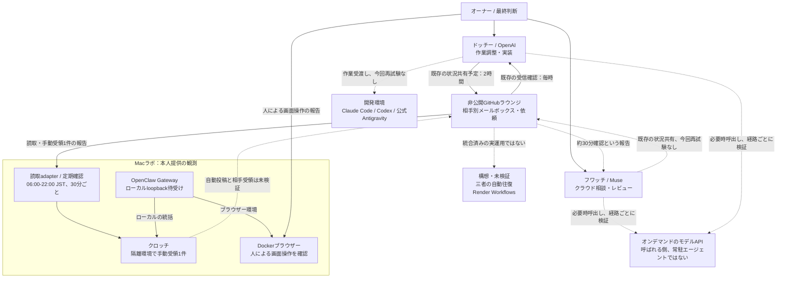

# ネットワーク構成 — 2026-11-06

[English](network-topology-2026-11-06.md) | [日本語](network-topology-2026-11-06.ja.md)

現在の構成は **メールボックスを介した非同期のチーム** です。三者の自律会話が検証済みという意味ではありません。ドッチーは実装・進捗調整、フワッチ（Muse）はクラウド側の相談・設計・レビュー、クロッチ（旧文書のKurocchi）はMac上のOpenClawによるラボ運用を担当します。非公開GitHubラウンジが相手別メールボックスと依頼を保持します。モデルAPIは呼び出される側であり、独立した常駐エージェントではありません。

**既存の運用と観測段階。** ドッチーの既存予定はMuse宛の状況共有が2時間ごと、受信確認が毎時です。Museには約30分確認という報告がありますが、実ジョブ定義や各便の配送を今回再試験していません。クロッチの受信確認は06:00〜21:30の各30分と22:00（JST）に登録されています。メールボックス読取、別途の手動受領1件、11月5日22:00の自然起動は本人提供の実行結果で確認された段階です。これらは別々の観測であり、自動返信や相手の受領を証明しません。

**Macとブラウザーの境界。** OpenClaw Gateway/CLI 2026.10.10、Gateway稼働、loopback待受けが報告されています。ブラウザーはDocker環境にあり、その後の本人報告で人による画面接続とクリップボード試験が確認されました。11月5日のビルドのみの記録から前進していますが、自律ブラウザー操作、認証情報の隔離、Docker管理権限の限定は証明していません。OpenShellのプラグイン・workspace準備も、実タスクの制約が強制される証拠ではありません。

**準備・構想段階。** 三者の自動往復、共通の30分送信間隔、オフライン統合harnessの実adapter接続は未検証です。Metaのプラグイン・profile準備は報告されていますが、その構成でのAPI応答は未試験です。Render Workflowsは[PR #40](https://github.com/moruku36/multi-ai-workflow/pull/40)のオンデマンド実行案であり、配備済みの基盤ではありません。Windows/OCIの開発担当やAPI経路は過去の記録に保持し、この断面で稼働状態を再認定しません。

図は論理的な関係であり、物理経路や安全性の認定ではありません。実線は既存の運用関係または限定的な報告観測で、ラベルがその範囲を示します。破線は未検証・今回再試験なし・構想の関係です。どちらも各便の成功を保証しません。

## 根拠と限界

- [通信状況](communication-status-2026-11-06.ja.md)：方向別の確認間隔・読取・手動受領・定期起動。12件のオフライン試験は実通信試験ではありません。
- [11月5日の構築メモ](openclaw-build-notes-2026-11-05.ja.md)：Gateway版、loopback、Dockerビルド、OpenShell準備と残る安全性確認。その後の画面・クリップボード観測は本人報告で、独立再試験ではありません。
- [11月2日の断面](architecture-snapshot-2026-11-02.ja.md)と[10月30日の構成](network-topology-2026-10-30.ja.md)：過去の役割・クラウド開発・API経路。旧PNGは過去資料として残し、上のMermaidが11月6日の図です。
- loopbackは管理経路全体を保証せず、侵害済みホストからの防御も保証しません。コンテナー実行だけでは認証情報・ホストの隔離を証明しません。
- 既存記録を整理した文書上の断面であり、新たな実機試験ではありません。私的メール本文、ホスト識別子、アドレス、ポート、認証値は掲載しません。
