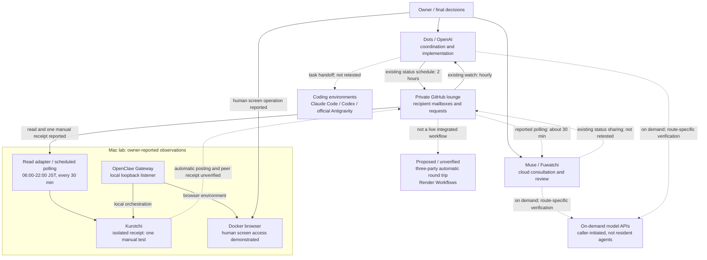

# Network topology — 2026-11-06

[English](network-topology-2026-11-06.md) | [日本語](network-topology-2026-11-06.ja.md)

The current topology is an **asynchronous mailbox-based team**, not a verified three-agent autonomous conversation. Dots coordinates implementation and status; Muse (Fuwatchi) handles cloud-side consultation, design and review; Kurotchi (Kurocchi in older records) is the Mac-local OpenClaw lab agent. A private GitHub lounge holds recipient mailboxes and requests. Model APIs are invoked by a caller, not independent resident agents.

**Existing operation and observed stages.** Dots' existing schedule sends status toward Muse every two hours and checks incoming messages hourly. Muse's approximately half-hour polling is reported, but its actual job definition and each delivery were not retested here. Kurotchi's receiving schedule is registered every half-hour from 06:00 to 21:30 plus 22:00 JST. Mailbox reading, one separate manual receipt, and natural scheduled execution at 22:00 on November 5 are evidenced in owner-supplied results. These are separate observations, not proof of automatic replies or recipient acknowledgment.

**Mac and browser boundary.** OpenClaw Gateway/CLI 2026.10.10, Gateway operation and a loopback listener were reported. The browser runs in a Docker environment; subsequent owner reports demonstrate human screen access and a clipboard test. This advances the November 5 build-only record, but does not establish autonomous browser operation, credential isolation, or restricted Docker-management authority. OpenShell plugin/workspace preparation likewise does not establish enforced constraints on a real task.

**Prepared or proposed.** Three-party automatic round trips, a common 30-minute sending cadence and the live adapters for the offline integration harness remain unverified. Meta plugin/profile preparation has been reported; an API response has not been tested in that setup. Render Workflows is an on-demand execution proposal in [PR #40](https://github.com/moruku36/multi-ai-workflow/pull/40), not deployed infrastructure. Historical Windows/OCI coding roles and API routes are retained in the dated record; this snapshot does not recertify their runtime availability.

The diagram shows logical relationships, not physical routing or a security certification. Solid arrows indicate an existing operating relationship or a reported limited observation, with the label defining its scope. Dashed arrows are unverified, not retested, or proposed. Neither line style proves every run succeeds.

## Evidence boundaries

- [Communication report](communication-status-2026-11-06.md): per-direction polling, read, manual receipt and scheduled-execution observations; twelve offline tests are not live communication tests.
- [November 5 setup notes](openclaw-build-notes-2026-11-05.ja.md): Gateway version, loopback, Docker builds, OpenShell preparation and outstanding security checks. Later human screen/clipboard observations above are owner-reported, not independently reproduced.
- [November 2 snapshot](architecture-snapshot-2026-11-02.md) and [October 30 topology](network-topology-2026-10-30.md): historical roles, cloud development and API routes. Old PNGs remain historical; the Mermaid above is the November 6 diagram.
- The loopback boundary does not guarantee the complete management path or protect against an already-compromised host. Container execution does not by itself prove credential or host isolation.
- This is a documentation-only snapshot of available records, not a fresh machine test. No private mailbox contents, host identifiers, addresses, ports or authentication values are published.
