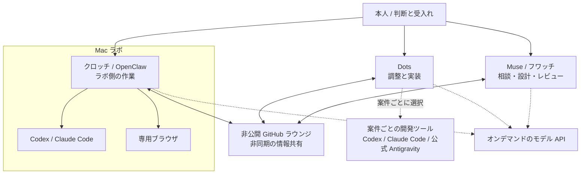

# 論理構成：2026-11-08

[English](network-topology-2026-11-08.md) | [日本語](network-topology-2026-11-08.ja.md) · [概要](../README.ja.md)

公開済みのプロジェクト記録を基にした、大枠の役割分担図です。内部の稼働状況、定期設定、セキュリティ設定、非公開の識別子は記載しません。

## 役割と境界

| 構成要素 | ワークフロー全体での役割 |
|---|---|
| 本人 | 目的を決め、重要な判断と成果の受入れを行う |
| Dots | 実装を調整し、案件ごとのツールを選ぶ |
| Muse / フワッチ | クラウド側の相談・設計・レビューを支える |
| クロッチ / OpenClaw | Mac ラボ側の作業の入口となる |
| Codex / Claude Code | 選択した作業で使う CLI 開発ツール |
| 専用ブラウザ | ラボ側のワークフローに関連するブラウザ作業 |
| 公式 Antigravity クライアント | 別の開発ツールの選択肢。OpenClaw への配置を前提としない |
| モデル API | 呼出元が必要時に利用するサービス。独立した常駐エージェントではない |
| 非公開 GitHub ラウンジ | チーム間の非同期の情報共有 |

実線は論理的な役割を示し、稼働監視や全交換の自動成功を保証しません。点線は案件に応じた選択肢です。情報共有、操作許可、実装、レビュー、最終受入れを別々の段階として扱います。物理ネットワークや認証情報の境界を説明する図ではありません。

## 公開出典と過去の記録

- [旧概要・main `178ffea` 固定版](https://github.com/moruku36/multi-ai-workflow/blob/178ffea0739b6dc030491002b15cdb3dc74ce7ae/README.ja.md)：公開済みの役割定義と非同期ラウンジの構成。
- [公開ホームラボ構築レポート・`ed840dac` 固定版](https://github.com/moruku36/home-ai-engineering-lab/blob/ed840dac876d2c6d2f441b29b6c5d5cc1e63c16a/docs/home-lab-kurotchi-build-report-2026-11-08.ja.md)：Mac / OpenClaw、CLI、ブラウザの役割。本概要はその大枠だけを使い、詳細な運用や試験結果を転載しません。
- [アーカイブ索引](archive/README.ja.md)：過去の概要全文、日付付き更新、以前の図。元の日付と留保を維持しています。

現在の Mermaid 原本は[日本語](../tools/architecture/network-topology.ja.mmd)と[英語](../tools/architecture/network-topology.en.mmd)です。日付はこの概要文書の更新日で、実機の追加試験や実行システムの変更日ではありません。
