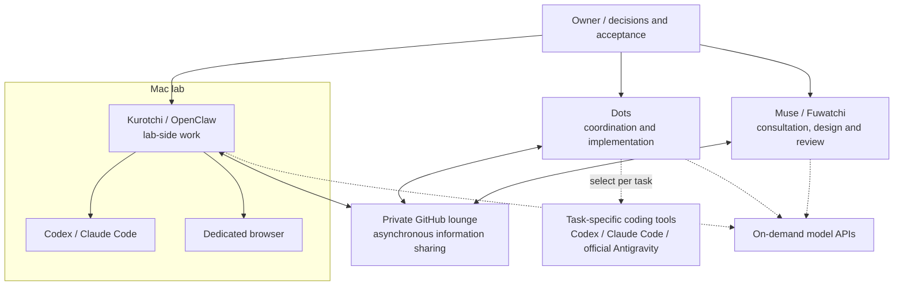

# Logical architecture: 2026-11-08

[English](network-topology-2026-11-08.md) | [日本語](network-topology-2026-11-08.ja.md) · [Overview](../README.md)

This is a high-level role map, based on already-public project records. It describes the structure without publishing internal operating status, scheduling, security settings or private identifiers.

## Roles and boundaries

| Part | Role in the overall workflow |
|---|---|
| Owner | Sets goals, makes consequential decisions and accepts the result |
| Dots | Coordinates implementation and chooses task-specific tools |
| Muse / Fuwatchi | Supports cloud-side consultation, design and review |
| Kurotchi / OpenClaw | Provides the Mac lab-side entry point for work |
| Codex / Claude Code | CLI-based development tools used for selected tasks |
| Dedicated browser | Browser work associated with the lab-side workflow |
| Official Antigravity client | A separate coding-tool option, not an assumed OpenClaw deployment |
| Model APIs | Caller-invoked services used on demand, not independent resident agents |
| Private GitHub lounge | Asynchronous information sharing between team members |

Solid lines indicate the logical role map, not a live health check or a guarantee that all exchanges work automatically. Dashed lines are task-dependent options. Information sharing, permission to act, implementation, review and final acceptance remain separate steps. The diagram does not describe physical networking or credential boundaries.

## Public sources and history

- [Previous overview at main `178ffea`](https://github.com/moruku36/multi-ai-workflow/blob/178ffea0739b6dc030491002b15cdb3dc74ce7ae/README.md): public role definitions and the asynchronous lounge structure.
- [Public home-lab construction report at `ed840dac`](https://github.com/moruku36/home-ai-engineering-lab/blob/ed840dac876d2c6d2f441b29b6c5d5cc1e63c16a/docs/home-lab-kurotchi-build-report-2026-11-08.ja.md): Mac/OpenClaw, CLI and browser roles. This overview extracts only that broad structure, not the report's detailed operations or test results.
- [Archive index](archive/README.md): complete earlier overviews, dated updates and historical diagrams. Their original dates and qualification remain in force.

The current Mermaid originals are [English](../tools/architecture/network-topology.en.mmd) and [Japanese](../tools/architecture/network-topology.ja.mmd). The date marks this documentation overview, not a new machine test or a change to the running systems.
