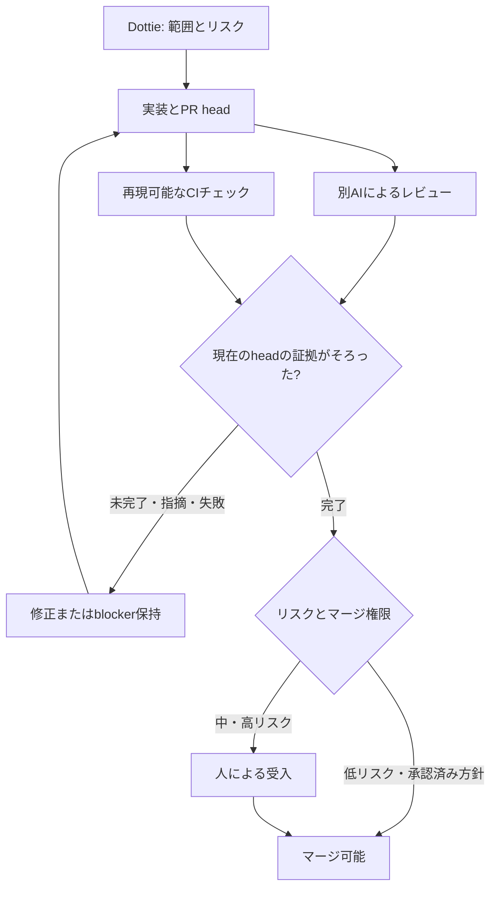

# Codex Review / PR Review Pipeline

[English](pr-review-pipeline.md) | [日本語](pr-review-pipeline.ja.md)

更新日：**2026-10-13（Asia/Tokyo）**。状態：文書化した運用方針。自動レビュー、必須チェック、自動マージは、対象リポジトリごとの設定・実証が済むまで **runtime pending** です。

AIが書いた変更を、別のレビュー担当と再現可能なチェックで検証します。レビュー依頼、受付、レビュー完了、CI成功、マージ権限は、それぞれ別の証拠として扱います。

## 役割と独立性

| 段階 | 担当 | 境界 |
|---|---|---|
| 範囲・リスク | Dottie + Product Owner | 受入条件、リスク、レビュー担当、作業上限を決める |
| 実装・修正 | Claude CodeまたはGemini/Antigravity。選定時はCodex | コード、回帰チェック、範囲を限定したPRを作る |
| Codex Review | Claude/Geminiの変更をCodexがレビュー | 差分と関連文脈を確認し、全面再実装にしない |
| 別の独立レビュー | Codex実装時はClaudeまたはGemini | 新しいCodexセッションだけでは別providerレビューにならない |
| 機械的な検証 | 対象repoのGitHub Actions / CI | レビュー対象headに対して適切な試験・lint・build・セキュリティ確認を実行 |
| 受入・マージ | Product Ownerまたは明示的に認可されたmaintainer | 証拠を確認し、重大な不確実性を解消する |
| 将来候補 | RunPod A100 Qwen | 品質評価後に採用。GPU起動やレビュー品質の受入済みとは扱わない |

Antigravityは環境名です。観測できた実providerを記録し、不明なら`UNKNOWN`とします。別アカウントや別quota poolだけでは独立性を証明できません。Codexに範囲を限定したPRレビューの役割を追加しますが、通常の文章・調査をすべて全面再レビューする方針にはしません。

## パイプラインと修正ループ

1. base SHA、head SHA、受入条件、変更files、リスク、レビュー担当をPRに固定します。関連コード・要件を渡し、実装者の説明を追認するだけの依頼にしません。
2. 実装担当が適切なチェックを実行し、コマンド・結果・不足を報告します。変更した挙動を検証し、必要なら否定ケース・回帰ケースも含めます。
3. 別担当へレビューを依頼します。Claude/Gemini実装にはCodex、Codex実装にはClaude/Geminiを選びます。担当が使えない場合は差分を保持し、レビューを`pending`または`blocked`とします。自己確認を独立レビュー扱いにしません。
4. CIとレビューを同じhead SHAに結び付けます。指摘には重大度、file/line、根拠、影響、再現・確認方法を含めます。reviewer/provider、結果URL、確認したSHA、未検証の前提を記録します。
5. 指摘を確認してから最小限の修正を行います。push後は以前のheadへのマージ判断を無効にし、影響するチェックと範囲を限定したレビューを更新します。必須チェックの失敗・未実施・cancel・適用不明を成功扱いにしません。
6. 現在のheadの受入条件、必須チェック・レビュー、blocking指摘の解消、マージ権限を確認してから統合します。修正ループには上限を設け、上限に達したら成果物を保持して判断を戻します。

## Codexの利用入口

[公式GitHub連携ガイド](https://learn.chatgpt.com/docs/third-party/github)では、repoの接続とレビュー設定後に`@codex review`で依頼する方法を説明しています。自動レビューは別設定です。GitHub connectorが使えることだけではCode Review設定済みとは判断できません。最初のリアクションだけでなく、対象headのレビュー完了を確認します。

repo固有のルールはルートの[AGENTS.md](../AGENTS.md)に置きます。ルールはレビューを導き、試験とrepo保護設定がゲートを強制します。[公式レビュー規則の説明](https://developers.openai.com/blog/custom-code-review-rules-for-codex)を**2026-10-13**に確認しました。指摘なしや重大度で絞られたレビューだけでは全不具合の検出を証明できません。受入条件と試験不足も確認します。

## 再現可能な品質ゲート

次は対象repoへの推奨です。この文書repoで新規workflowを有効化したという意味ではありません。

| ゲート | 適用場面 | 証拠 |
|---|---|---|
| 単体・回帰試験 | 実行挙動の変更 | コマンド、件数・結果、回帰ケース、head SHA |
| 結合・E2E | interface、永続化、ユーザーフローの変更 | 環境、fixture境界、結果、runtime不足 |
| lint・型・build | 言語や成果物に応じて適用 | 適切な機械的チェックと出力 |
| SemgrepまたはCodeQL | 対応する実行コード・securityに関わる変更 | 設定したルール/query、結果、指摘の確認 |
| 依存・secret・container scan | 依存、secret露出、imageが対象 | scanner/version/config、結果、例外と理由 |
| 文書チェック | 文書だけのPR | 相対リンク、日英整合、空白、公開情報確認 |

AIの「試験成功」という報告だけでなく、参照可能なログや再現可能な結果を残します。scannerはレビューを補完し、脆弱性ゼロを保証しません。例外は明記して承認し、必須ゲートを黙ってskipしません。

## リスクに応じたマージ

| リスク | 例 | 判断 |
|---|---|---|
| 低 | 実行・security影響がない限定的な文書・表示変更 | 原則は人がマージ。明示承認され設定済みの方針と最新チェック・レビューがある場合だけ条件付き自動マージ |
| 中 | 挙動修正、API処理、依存変更 | 現headの証拠と回帰確認を人が受入 |
| 高 | 認証・認可、secret、CI権限、infra、データ移行、削除、互換性破壊 | 人と適切な専門担当の確認。必要なrollback・復旧の証拠 |

拡張子ではなく影響で分類します。実行コマンドや機密露出を含む文書も高リスクになり得ます。リスク不明・証拠不足は自動マージ対象外です。AIコメントは助言であり、必須チェック・レビューはbranch/ruleset設定で強制します。今回の更新は自動マージ有効化、repo保護変更、scanner導入、認証情報追加、GPU/API課金を行いません。

## 試行と受入

自動化前に既知の不具合、安全な反例、無関係な変更で試行します。有効な検出、見逃し、誤検知、レビュー時間、修正回数、費用を記録し、合意した基準で評価してからQwenなどの候補を採用します。**文書化・設定・実行・検証**を区別し、今回の更新で別providerの試行完了は主張しません。

[PR handoffテンプレート](handoff-templates.ja.md#7-pr-review-evidence)と[PRテンプレート](../.github/pull_request_template.md)を使います。Dottieは進捗、AI Governance Controlはhandoff/artifact/evidenceの契約、AIteamBridgeは別のrouting/transport開発を担当します。
