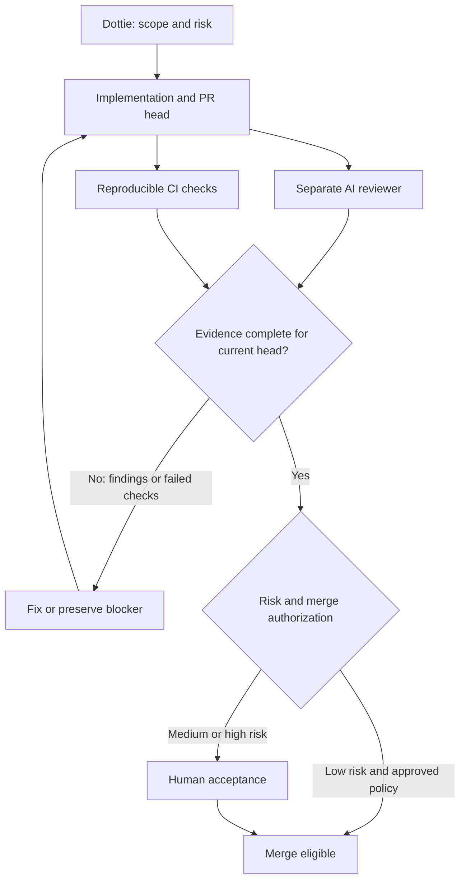

# Codex Review / PR Review Pipeline

[English](pr-review-pipeline.md) | [日本語](pr-review-pipeline.ja.md)

Updated: **2026-10-13 (Asia/Tokyo)**. Status: documented operating policy; automatic review, required checks and automatic merge are **runtime pending** until separately configured and verified in each target repository.

The goal is to verify AI-written changes with a separate reviewer and reproducible checks. A review request, an acknowledgment, a completed review, passing CI and permission to merge are different evidence states.

## Roles and independence

| Stage | Responsibility | Boundary |
|---|---|---|
| Scope / risk | Dottie + Product Owner | Define acceptance criteria, risk, reviewer and work limit (max 2 concurrent tasks) |
| Implementation / fixes | Gemini 3.8 Flash baseline (escalating to Sonnet/higher on demand); Codex when selected | Commit code, regression checks and a bounded PR |
| Independent review candidates | Xiaomi MiMo-V2.6-Pro API (candidate), Codex Review, Claude/Gemini | Separate provider from builder. Do not fix MiMo as sole reviewer; differentiate depth between routine and governance docs |
| Deterministic verification | Target repository's GitHub Actions / CI | Run applicable tests, lint, build and security checks at the reviewed head |
| Acceptance / merge | Product Owner or explicitly authorized maintainer | Confirm exact head SHA match, CI pass, resolution of Blocker/Major findings, and human acceptance |
| Future review candidate | RunPod A100 Qwen | Benchmark quality first; no GPU startup or accepted review quality is implied |

Antigravity is an environment, not a provider: record the actual provider if observed, otherwise `UNKNOWN`. Different accounts or quota pools alone do not establish independence. Codex and MiMo have explicit bounded review roles; ordinary prose and research do not acquire mandatory comprehensive review. Furthermore, review depth is tiered between routine documentation (typos, layout) and governance/security documentation to eliminate redundant reviews for identical objectives.

## Pipeline and correction loop

1. Freeze the base SHA, head SHA, acceptance criteria, changed files, risk and selected reviewer in the PR. Provide relevant code and requirements; do not ask the reviewer to simply endorse the builder's explanation.
2. The builder runs applicable checks and reports commands, results and gaps. Tests should exercise the changed behavior, including a negative or regression case when useful.
3. Request a separate review. Codex is a candidate for Claude/Gemini PRs; choose Claude/Gemini for Codex-authored work; Xiaomi MiMo-V2.6-Pro API is an independent candidate. If unavailable, preserve the diff and mark review `pending` or `blocked`; do not treat the builder's self-check as independent review.
4. Run CI and review against the same head SHA. Findings need severity, file/line, evidence, impact and a reproduction or check. Record reviewer identity/provider, result URL, reviewed SHA and unverified assumptions.
5. Validate findings before applying minimal fixes. A new push invalidates the previous head's merge decision: rerun affected checks and obtain an updated scoped review. Failed, missing, canceled or inapplicable-required checks do not count as passing.
6. Merge only after the current head satisfies acceptance, required CI/checks and reviews, all Blocker and Major findings are resolved, and human Product Owner acceptance exists. Bound repair loops; when the agreed work limit is reached, retain artifacts and escalate.

## Codex entry point

The [official GitHub integration guide](https://learn.chatgpt.com/docs/third-party/github) describes requesting a review with `@codex review` after repository connection and review setup. Automatic review is a separate setting; access to this GitHub connector does not prove Code Review is configured. Check for a completed review of the intended head, not only the initial reaction.

Use the root [AGENTS.md](../AGENTS.md) for repository-specific review rules. These guide review, while tests and repository protections enforce gates. Reference: [official review-rules guidance](https://developers.openai.com/blog/custom-code-review-rules-for-codex), checked **2026-10-13**. A missing finding or severity-filtered review is not proof that all defects were found; explicit acceptance and test gaps still need review.

## Reproducible quality gates

These are target-repository recommendations, not newly enabled workflows in this documentation repository.

| Gate | Use when | Evidence |
|---|---|---|
| Unit / regression tests | Executable behavior changes | Commands, test counts/results, regression case and head SHA |
| Integration / end-to-end | Interfaces, persistence or user flows change | Environment, fixture boundaries, results and runtime gaps |
| Lint / type / build | Relevant language or artifact changes | Applicable deterministic checks and outputs |
| Semgrep or CodeQL | Supported executable code and security-sensitive changes | Configured rules/query set, result and triaged findings |
| Dependency / secret / container scan | Dependencies, secrets exposure or images are in scope | Scanner/version/config, result, exceptions and rationale |
| Documentation checks | Docs-only PR | Relative links, bilingual consistency, whitespace and disclosure check |

An AI claim that tests passed is not a substitute for accessible logs or reproducible results. A security scanner complements review and does not certify vulnerability absence. Keep exceptions explicit and approved; never silently skip a required gate.

## Risk-based merge policy

| Risk | Examples | Merge decision |
|---|---|---|
| Low | Bounded docs or presentation changes without execution/security impact | Human merge by default; conditional auto-merge only under an explicitly approved, configured policy with current checks/review |
| Medium | Behavior fixes, API handling, dependencies | Human acceptance of current-head evidence and regression coverage |
| High | Authentication/authorization, secrets, CI permissions, infrastructure, data migration, deletion, breaking contracts | Human and relevant specialist review; rollback/recovery evidence as applicable |

Classify by impact, not extension: docs containing executable commands or sensitive disclosures can be high risk. Unknown risk or incomplete evidence cannot enter automatic merge. AI comments are advisory; branch/ruleset settings must enforce required checks and reviews. This update does not enable auto-merge, change repository protections, install scanners, add credentials or incur GPU/API charges.

## Trial and acceptance

Before enabling automation, trial known faulty changes, safe counterexamples and unrelated changes. Record actionable detection, misses, false positives, review latency, repair cycles and cost. Review the result against agreed criteria before promoting a candidate such as Qwen. Keep **documented**, **configured**, **executed**, and **verified** distinct; no completed cross-provider trial is claimed by this update.

Use the [PR handoff template](handoff-templates.md#7-pr-review-evidence) and [pull request template](../.github/pull_request_template.md). Dottie tracks progress; AI Governance Control stores the handoff/artifact/evidence contract; AIteamBridge remains the separate routing/transport project.
